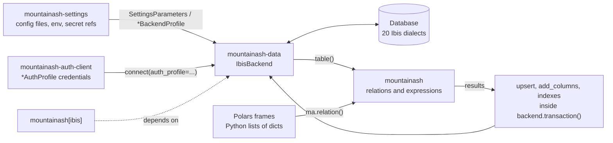

# mountainash-data in the mountainash ecosystem

`mountainash-data` is the physical data layer of the mountainash ecosystem. It turns [`mountainash-settings`](https://github.com/mountainash-io/mountainash-settings) configuration and [`mountainash-auth-client`](https://github.com/mountainash-io/mountainash-auth-client) credentials into live database connections through one class, `IbisBackend`, which serves 20 Ibis dialects from in-process SQLite and DuckDB to PostgreSQL, Snowflake, BigQuery and Trino. It hands each database table to [`mountainash`](https://github.com/mountainash-io/mountainash) relations and expressions, then writes the results back with portable upserts, column additions and indexes inside explicit transaction scopes.

The workflow runs settings, then data, then expressions, then back to data. A connection comes from a config file, environment variables or a secret store rather than from code. A `mountainash` expression is written once and runs anywhere: the same `ma.col("total").gt(90)` filters a local Polars frame or a warehouse table, and a relation over a database table joins Polars dataframes and plain Python lists of dicts in one plan. Moving from DuckDB on a laptop to PostgreSQL or Snowflake in production changes the configuration, not the pipeline.

## What the package does

<!-- concept:1 -->
The package targets SQL databases: systems that store named tables of typed columns, answer SQL and expose metadata about their own tables and columns. Every dialect speaks a slightly different SQL. Upsert syntax, `ALTER TABLE` forms, index DDL, identifier quoting, transaction behaviour and the naming of schemas and catalogs all vary. `mountainash-data` absorbs those differences so calling code uses one set of methods whatever engine sits underneath:

```python
import pyarrow as pa

from mountainash_data import IbisBackend

orders = pa.table({"id": [1, 2], "total": [120, 95]})

with IbisBackend(dialect="duckdb", database=":memory:") as backend:
    backend.raw_driver_connection().execute("CREATE SCHEMA sales")
    backend.create_table("orders", orders, namespace="sales")
    print(backend.list_catalogs())
    print(backend.list_namespaces())
    print(backend.list_tables(namespace="sales"))
    print(backend.inspect_table("orders", namespace="sales").location)
```

```text
['memory', 'system', 'temp']
['information_schema', 'main', 'pg_catalog', 'sales']
['orders']
Namespace(path=('sales',), catalog=None)
```

Changing `dialect="duckdb"` to another dialect, with that engine's connection arguments, leaves the rest of the code unchanged.

| Area | Capability | Chapter |
|---|---|---|
| Connections | Dialect keyword arguments, URLs, typed settings profiles, separate auth profiles | [Installing and connecting](../02-installing-and-connecting/index.md), [Connection profiles and authentication](../03-connection-profiles-and-authentication/index.md), [Configuring connections with mountainash-settings](../04-configuring-connections-with-mountainash-settings/index.md) |
| Physical metadata | Catalogs, namespaces, tables, columns and indexes as typed results | [Inspecting databases](../05-inspecting-databases/index.md) |
| Tables and queries | Create, insert, read, drop; run Ibis expressions and SQL; hand tables to `mountainash` | [Reading tables and running queries](../06-reading-tables-and-running-queries/index.md), [Running mountainash expressions against databases](../07-running-mountainash-expressions-against-databases/index.md) |
| Mutations and indexes | Upsert, add columns, rename, truncate; create, list and drop indexes | [Creating and changing tables](../08-creating-and-changing-tables/index.md), [Indexes](../09-indexes/index.md) |
| Transactions | Reentrant commit/rollback scopes that join a caller's open transaction | [Transactions](../10-transactions/index.md) |
| Adoption | Wrap an existing Ibis or driver connection without taking ownership | [Adopting existing connections](../11-adopting-existing-connections/index.md) |
| The whole workflow | Config file to connection, joins with local data, upsert in a transaction | [An end-to-end pipeline](../12-an-end-to-end-pipeline/index.md) |

## Databases, schemas and catalogs as the package models them

<!-- concept:2 -->
A schema is a named container for tables inside a database. PostgreSQL calls it a schema, MySQL treats each database as one, BigQuery calls it a dataset and Trino places schemas inside catalogs. The package uses one neutral word for all of these: a **namespace**. Methods that take a table location accept `namespace=` as a plain string (`"sales"`), a tuple of path levels, or a `Namespace` value object. `Namespace.path` holds the levels between the catalog and the table, and `None` means the connection's current default. Ibis operations support at most one namespace level; unsupported shapes raise `ValueError`.

<!-- concept:3 -->
A catalog sits one level above namespaces. DuckDB's catalogs are attached databases (`memory`, `system`, `temp` above), Snowflake and Databricks use catalogs as top-level databases, and SQLite effectively has one. `Namespace.catalog` names a catalog explicitly and is never inferred from a tuple position, so `("analytics", "sales")` is always a two-level path. Inspection follows the same three tiers: `list_catalogs()`, `list_namespaces(catalog=...)` and `list_tables(namespace=...)`, with `inspect_*` counterparts that return typed results ([Inspecting databases](../05-inspecting-databases/index.md)).

<!-- concept:4 -->
A connection is a live session with one database server or file, holding driver state, any open transaction and session settings such as the current schema. The package makes its lifecycle explicit. Constructing `IbisBackend` only records configuration; `connect()` opens the session and `close()` releases it, and the context manager does both. Credentials are supplied at `connect()` time, so a backend object holds no secrets until it connects. Ownership is explicit too: the backend closes a connection it opened, and leaves open one adopted from the caller with `from_ibis_connection()` or `from_raw_connection()`.

## Where Ibis fits

<!-- concept:10 -->
[Ibis](https://ibis-project.org/) is a Python dataframe library that compiles table expressions to each engine's SQL and runs them there. It ships a backend per engine, each of which can connect, list tables, create tables from dataframes and execute expressions.

`mountainash-data` builds on Ibis in two directions. Underneath, `IbisBackend.connect()` opens the Ibis backend for the chosen dialect, and operations such as creating, listing and reading tables delegate to it. On top, `table()` returns a plain Ibis table, which Ibis expressions or a `mountainash` relation can consume:

```python
import pyarrow as pa

from mountainash_data import IbisBackend

orders = pa.table({"id": [1, 2, 3], "total": [120, 95, 40]})

with IbisBackend(dialect="duckdb", database=":memory:") as backend:
    backend.create_table("orders", orders)
    t = backend.table("orders")            # an Ibis table expression
    expr = t.filter(t.total > 50).total.sum()
    print(type(t).__module__)
    print(backend.run_expr(expr))
```

```text
ibis.expr.types.relations
215
```

Where Ibis has no portable API, or its API does not cover every dialect, the package supplies its own: upsert across three SQL families (`ON CONFLICT`, `MERGE`, `ON DUPLICATE KEY`), adding columns, index management and transaction scopes, rendered through sqlglot or run on the native driver handle, with per-dialect overrides where a database needs them. Ibis knowledge helps but isn't required for this book; the [Ibis documentation](https://ibis-project.org/) covers expression building.

## The Backend protocol in one page

<!-- concept:5 -->
A Python protocol (PEP 544, `typing.Protocol`) describes a type by the attributes and methods it has rather than by what it inherits from. Any class with matching members satisfies it, and a type checker accepts that class wherever the protocol is expected. This is structural typing. The package uses it so a backend never has to subclass a package base class: `IbisBackend` is a plain class, and a backend for another kind of store could be written the same way without importing the Ibis layer.

<!-- concept:6 -->
Decorating a protocol with `@typing.runtime_checkable` lets `isinstance()` test conformance at run time. The check is shallow: it confirms each named member exists, not that signatures or return types match.

```python
from mountainash_data import Backend, IbisBackend

backend = IbisBackend(dialect="sqlite", database=":memory:")
print(isinstance(backend, Backend))


class NotABackend:
    name = "half"

    def connect(self):
        return self


print(isinstance(NotABackend(), Backend))
```

```text
True
False
```

A class that defined every member with the wrong signatures would still pass `isinstance()`, so a conformance test should also call the members and check their results. [Extending mountainash-data](../17-extending-mountainash-data/index.md) shows how.

<!-- concept:11 -->
`Backend`, defined in `mountainash_data.core.protocol` and exported from the package root, is the contract every backend satisfies:

| Group | Members |
|---|---|
| Identity and lifecycle | `name`; `connect()` and `close()`, both returning the backend; `__enter__` and `__exit__` |
| Listing | `list_catalogs()`, `list_namespaces(catalog=None)`, `list_tables(namespace=None)` |
| Inspection | `inspect_catalog(catalog=None)`, `inspect_namespace(name)`, `inspect_table(name, namespace=None)`, returning `CatalogInfo`, `NamespaceInfo` and `TableInfo` |
| Driver access and transactions | `raw_driver_connection()`, `supports_transactions`, `transaction(required=True)`, `native_transaction_open()`, `in_transaction()` |

The protocol stops at connection, inspection and transactions. Table writes, upsert, indexes and query execution are `IbisBackend` methods, because their shape depends on the backend family. There is no conversion to a `mountainash` relation on the protocol either: the handoff is pull-side, through the native table that `table()` returns. Code that must work with any backend types its parameters as `Backend`; code that needs writes or Ibis tables types them as `IbisBackend`.

## Python ideas the package leans on

<!-- concept:7 -->
Connection settings are [pydantic](https://docs.pydantic.dev/) models. Each database has a `*BackendProfile` class whose fields are its connection parameters in upper case (`HOST`, `PORT`, `DATABASE`, `SSL_MODE`). Pydantic validates and converts values when a profile is built, so a port given as a string becomes an `int` and a malformed value fails before any connection is attempted:

```python
from mountainash_data.core.settings import PostgreSQLBackendProfile

profile = PostgreSQLBackendProfile(HOST="db.example", DATABASE="app", PORT="6543")
print(profile.PORT, type(profile.PORT).__name__, profile.SSL_MODE)

try:
    PostgreSQLBackendProfile(HOST="db.example", PORT="not-a-port")
except Exception as exc:
    print(type(exc).__name__, exc.errors()[0]["loc"], exc.errors()[0]["msg"])
```

```text
6543 int prefer
ValidationError ('PORT',) Input should be a valid integer, unable to parse string as an integer
```

The profiles build on the settings base in `mountainash-settings`, which is what lets them load from config files, environment variables and secret stores ([Configuring connections with mountainash-settings](../04-configuring-connections-with-mountainash-settings/index.md)). Credentials are separate pydantic models (`PasswordAuthProfile`, `TokenAuthProfile` and others) from `mountainash-auth-client`, whose secret fields are `SecretStr` and print as asterisks ([Connection profiles and authentication](../03-connection-profiles-and-authentication/index.md)).

<!-- concept:8 -->
A decorator is a callable applied to a function or class at definition time with `@name` syntax; it receives the object and returns it, possibly after recording or changing it. The package uses decorators for registration rather than wrapping. Every backend profile is declared as `@register class PostgreSQLBackendProfile(BackendProfile): ...`, and `register` records the class under its spec's name as a side effect of the class statement. The standard-library `@dataclass(frozen=True)` (inspection results and `Namespace`) and `@runtime_checkable` (`Backend`) appear throughout as well.

<!-- concept:9 -->
A registry maps a name to a definition, filled as definitions are declared, so dispatching code never needs a hard-coded list. The package keeps two. The settings registry, `DATABASES_REGISTRY`, maps a backend name such as `"postgresql"` to its spec and profile class; `@register` fills it when `mountainash_data.core.settings` is imported, and `get_settings_class()` and `get_descriptor()` read it. The dialect registry maps each of the 20 Ibis dialect names to a `DialectSpec` record holding the connection builder, URL scheme, transaction support level and per-operation hooks, which `IbisBackend` looks up at construction ([How one backend serves 20 dialects](../14-how-one-backend-serves-20-dialects/index.md)). Adding a database means adding registry entries, not editing `IbisBackend`.

## The mountainash ecosystem layers

<!-- concept:157 -->
Four packages split the work between configuration, credentials, physical access and logic. Configuration and credentials flow in from the left, the database sits under `mountainash-data`, and `mountainash` relations sit on top, mixing database tables with local data before results flow back down as physical writes:



| Package | Owns |
|---|---|
| `mountainash-settings` | The settings base, config-file and environment loading, secret resolution, `SettingsParameters` recipes |
| `mountainash-auth-client` | Credential types and auth flows such as OAuth |
| `mountainash-data` | Connections and their lifecycle, physical metadata, native table access, physical writes and transaction scopes |
| `mountainash` | Expressions, relations and cross-source semantics, including joins between database tables and local data |

The boundary between the last two is an enforced design rule. `mountainash-data` never imports `mountainash` and has no `to_relation()` method; its public contract ends at the native table that `table()` returns. The application makes the handoff with `ma.relation(backend.table("sales"))`. Dependency runs the other way: the `mountainash[ibis]` extra depends on `mountainash-data` and borrows a connection through its public API (`IbisBackend.from_ibis_connection`) for SQL transactions and owned-copy work ([Adopting existing connections](../11-adopting-existing-connections/index.md)). Base Polars execution in `mountainash` does not import this package.

## What it adds beyond Ibis

<!-- concept:158 -->
Code that only needs a connection and Ibis expressions can use Ibis directly. `mountainash-data` earns its place in the ecosystem workflow:

| Need | Ibis alone | With mountainash-data and the ecosystem |
|---|---|---|
| Configuration | Connection keyword arguments or a URL in code | Validated profiles loaded from config files, environment overrides and secret references; a `SettingsParameters` recipe travels to the worker that connects ([chapter 4](../04-configuring-connections-with-mountainash-settings/index.md)) |
| Credentials | Passed with the connection arguments | Separate auth profiles applied at `connect()`; the backend holds no secrets before then |
| Logic | Ibis expressions over Ibis backends | `mountainash` expressions written once, run on local frames or database tables, and joined across both ([chapter 7](../07-running-mountainash-expressions-against-databases/index.md)) |
| Writes | `create_table`, `insert`; upsert, rename and truncate on some backends | Upsert across three SQL families, `add_columns`, index management and per-dialect fixes behind one method each |
| Transactions | Driver-level `BEGIN`/`COMMIT` | `transaction()` scopes that own or join the caller's transaction, plus `in_transaction()` |
| Metadata | Table and schema listing | Typed catalog, namespace, table, column and index results, the same for every backend |

The same expression filters a Polars frame and a DuckDB table, the DuckDB result joins a Polars frame and a list of dicts, and the result is upserted back in a transaction:

```python
import mountainash as ma
import polars as pl

from mountainash_data import IbisBackend

sales = pl.DataFrame({"id": [1, 2, 3], "region": ["n", "s", "n"], "total": [120, 40, 95]})
big_sale = ma.col("total").gt(90)

print(ma.relation(sales).filter(big_sale).sort("id").to_polars().to_dicts())

with IbisBackend(dialect="duckdb", database=":memory:") as backend:
    backend.create_table("sales", sales.to_arrow())
    db_sales = ma.relation(backend.table("sales"))
    print(db_sales.filter(big_sale).sort("id").to_polars().to_dicts())

    managers = pl.DataFrame({"region": ["n", "s"], "manager": ["Ada", "Lin"]})
    targets = [{"region": "n", "target": 200}, {"region": "s", "target": 50}]
    report = (
        db_sales.filter(big_sale)
        .join(ma.relation(managers), on="region")
        .join(ma.relation(targets), on="region")
        .sort("id")
        .to_polars()
    )
    print(report.to_dicts())

    backend.raw_driver_connection().execute(
        "CREATE TABLE flagged (id INTEGER PRIMARY KEY, total INTEGER)"
    )
    with backend.transaction():
        backend.upsert("flagged", report.select("id", "total"), conflict_columns="id")
    print(ma.relation(backend.table("flagged")).sort("id").to_polars().to_dicts())
```

```text
[{'id': 1, 'region': 'n', 'total': 120}, {'id': 3, 'region': 'n', 'total': 95}]
[{'id': 1, 'region': 'n', 'total': 120}, {'id': 3, 'region': 'n', 'total': 95}]
[{'id': 1, 'region': 'n', 'total': 120, 'manager': 'Ada', 'target': 200}, {'id': 3, 'region': 'n', 'total': 95, 'manager': 'Ada', 'target': 200}]
[{'id': 1, 'total': 120}, {'id': 3, 'total': 95}]
```

The filter runs in Polars for the local frame and compiles to DuckDB SQL for the table; `mountainash` plans the joins with local data, and `mountainash-data` performs the physical write. Swapping DuckDB for PostgreSQL changes the `IbisBackend` arguments (or the config file behind them) and nothing else. [An end-to-end pipeline](../12-an-end-to-end-pipeline/index.md) builds the same flow from a config file.

## How the book is organised

The chapters run from use to internals. Each part reads on its own once this chapter is familiar.

| Part | Chapters | For |
|---|---|---|
| Using the package | [2](../02-installing-and-connecting/index.md) to [13](../13-supported-databases-and-limits/index.md): connecting, profiles and auth, configuration with `mountainash-settings`, inspection, reading and querying, `mountainash` expressions, table changes, indexes, transactions, adoption, an end-to-end pipeline, and the per-dialect support matrix | Anyone writing code against the package |
| Architecture and internals | [14](../14-how-one-backend-serves-20-dialects/index.md) to [16](../16-transaction-and-adoption-internals/index.md): dialect dispatch, the settings-to-driver-arguments pipeline, and transaction and adoption internals | Readers who need to know how it works or maintain it |
| Extending | [17](../17-extending-mountainash-data/index.md) and [18](../18-contributing-and-testing/index.md): adding dialects, settings backends and protocol implementations; repository layout and tests | Extension authors and contributors |

The FAQ and glossary appendices link back to the section where each topic is explained.
