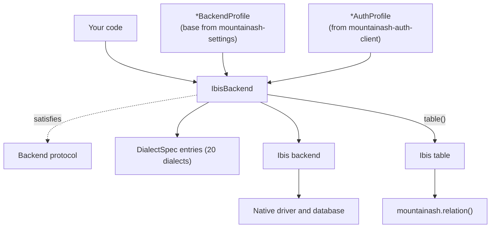

# What mountainash-data is

`mountainash-data` gives Python code one typed handle, `IbisBackend`, for connecting to relational databases, inspecting their physical metadata and managing their tables. The same class serves 20 database dialects, from in-process SQLite and DuckDB to PostgreSQL, Snowflake, BigQuery and Trino. Ibis supplies the backend-native table expressions; this package adds connection profiles, namespace handling, dialect-specific writes, index management and explicit transaction scopes, all behind a backend-neutral `Backend` protocol.

## What the package does

<!-- concept:1 -->
The package targets SQL databases: systems that store data in named tables of typed columns, answer SQL, and expose their own metadata about which tables and columns exist. Every dialect speaks a slightly different SQL. Upsert syntax, `ALTER TABLE` forms, index DDL, identifier quoting and transaction behaviour all vary, and so does the way each one names its schemas and catalogs. `mountainash-data` absorbs those differences so that calling code uses one set of methods whatever engine sits underneath.

A typical session looks like this:

```python
import pyarrow as pa

from mountainash_data import IbisBackend

orders = pa.table({"id": [1, 2], "total": [120, 95]})

with IbisBackend(dialect="duckdb", database=":memory:") as backend:
    backend.raw_driver_connection().execute("CREATE SCHEMA sales")
    backend.create_table("orders", orders, namespace="sales")
    print(backend.list_catalogs())
    print(backend.list_namespaces())
    print(backend.list_tables(namespace="sales"))
    print(backend.inspect_table("orders", namespace="sales").location)
```

```text
['memory', 'system', 'temp']
['information_schema', 'main', 'pg_catalog', 'sales']
['orders']
Namespace(path=('sales',), catalog=None)
```

Changing `dialect="duckdb"` to another dialect, with that engine's connection arguments, leaves the rest of the code unchanged.

What the package provides:

| Area | Capability | Chapter |
|---|---|---|
| Connections | Dialect keyword arguments, URLs, typed settings profiles, separate auth profiles | [Installing and connecting](../02-installing-and-connecting/index.md), [Connection profiles and authentication](../03-connection-profiles-and-authentication/index.md) |
| Physical metadata | Catalogs, namespaces, tables, columns and indexes as typed results | [Inspecting databases](../05-inspecting-databases/index.md) |
| Tables and queries | Create, insert, read, drop; run Ibis expressions and SQL | [Reading tables and running queries](../06-reading-tables-and-running-queries/index.md), [Creating and changing tables](../08-creating-and-changing-tables/index.md) |
| Mutations and indexes | Upsert, add columns, rename, truncate; create, list and drop indexes | [Creating and changing tables](../08-creating-and-changing-tables/index.md), [Indexes](../09-indexes/index.md) |
| Transactions | Reentrant commit/rollback scopes that join a caller's open transaction | [Transactions](../10-transactions/index.md) |
| Adoption | Wrap an existing Ibis or driver connection without taking ownership | [Adopting existing connections](../11-adopting-existing-connections/index.md) |

What other packages own:

| Concern | Owner |
|---|---|
| Building query expressions (filters, joins, aggregations) | [Ibis](https://ibis-project.org/). `table()` returns an Ibis table. |
| Relation semantics across engines | The `mountainash` package. Pass the Ibis table from `table()` to `mountainash.relation()`. |
| The pydantic settings base, configuration-file loading and secret resolution | [`mountainash-settings`](https://docs.mountainash.io/mountainash-settings/) |
| Credential types and auth flows such as OAuth | [`mountainash-auth-client`](https://docs.mountainash.io/mountainash-auth-client/) |

The package does not plan automatic joins between tables on different database connections.

The layers stack like this:



`IbisBackend` is the only class most code touches. It reads per-dialect behaviour from a `DialectSpec` record rather than from a subclass per database ([How one backend serves 20 dialects](../14-how-one-backend-serves-20-dialects/index.md) explains the mechanism). Settings profiles and auth profiles arrive from the sides, and Ibis does the connecting and the expression compilation underneath.

## Databases, schemas and catalogs as the package models them

<!-- concept:2 -->
A schema is a named container for tables inside a database. PostgreSQL calls it a schema, MySQL treats each database as one, BigQuery calls it a dataset and Trino calls it a schema inside a catalog. The package uses one neutral word for all of these: a **namespace**. Methods that take a table location accept a `namespace=` argument, which can be a plain string (`"sales"`), a tuple of path levels, or a `Namespace` value object. `Namespace.path` holds the levels between the catalog and the table, and `None` means "the connection's current default". Ibis operations support at most one namespace level; unsupported shapes raise `ValueError`.

<!-- concept:3 -->
A catalog sits one level above namespaces. DuckDB's catalogs are attached databases (`memory`, `system`, `temp` in the example above), Snowflake and Databricks use catalogs as top-level databases, and SQLite effectively has one. `Namespace.catalog` names a catalog explicitly and is never inferred from a tuple position, so `("analytics", "sales")` is always a two-level path, not a catalog plus a schema. The inspection methods follow the same three tiers: `list_catalogs()`, `list_namespaces(catalog=...)` and `list_tables(namespace=...)`, with `inspect_*` counterparts that return typed results. [Inspecting databases](../05-inspecting-databases/index.md) covers them in full.

<!-- concept:4 -->
A connection is a live session with one database server or file. It holds driver state, an open transaction if there is one, and session settings such as the current schema. The package makes the connection's lifecycle explicit. Constructing `IbisBackend` only records configuration; `connect()` opens the session; `close()` releases it; and using the backend as a context manager does both. Credentials are supplied at `connect()` time rather than at construction, so a backend object holds no secrets until it connects. Ownership is also explicit: a connection the backend opened is closed by the backend, while one adopted from the caller with `from_ibis_connection()` or `from_raw_connection()` is left open for the caller to close.

## Where Ibis fits

<!-- concept:10 -->
[Ibis](https://ibis-project.org/) is a Python dataframe library that compiles table expressions to each engine's SQL and runs them there. It ships a backend for each supported engine, and each backend knows how to connect, list tables, create tables from dataframes and execute expressions.

`mountainash-data` builds on Ibis in two ways. Underneath, `IbisBackend.connect()` opens an Ibis backend for the chosen dialect, and many operations (creating tables, listing tables, reading a table) delegate to it. On top, `table()` hands back a plain Ibis table, so queries are written with the Ibis expression API and executed through the backend:

```python
import pyarrow as pa

from mountainash_data import IbisBackend

orders = pa.table({"id": [1, 2, 3], "total": [120, 95, 40]})

with IbisBackend(dialect="duckdb", database=":memory:") as backend:
    backend.create_table("orders", orders)
    t = backend.table("orders")            # an Ibis table expression
    expr = t.filter(t.total > 50).total.sum()
    print(type(t).__module__)
    print(backend.run_expr(expr))
```

```text
ibis.expr.types.relations
215
```

Where Ibis has no portable API, the package supplies its own. Upsert, adding columns, renaming and truncating tables, index management and transaction scopes are rendered through sqlglot or run on the native driver handle, with per-dialect overrides where a database needs them. Ibis knowledge helps but isn't required for the rest of this book; the [Ibis documentation](https://ibis-project.org/) covers expression building.

## The Backend protocol in one page

<!-- concept:5 -->
A Python protocol (PEP 544, `typing.Protocol`) describes a type by the attributes and methods it has, not by what it inherits from. Any class with matching members satisfies the protocol, and a type checker accepts it wherever the protocol is expected. This is structural typing. `mountainash-data` uses it so that a backend never has to subclass a package base class: `IbisBackend` is a plain class, and a backend for some other kind of store could be written the same way without importing anything from the Ibis layer.

<!-- concept:6 -->
Decorating a protocol with `@typing.runtime_checkable` also lets `isinstance()` test conformance at run time. The check is shallow. It confirms that each named member exists on the object, not that signatures or return types match:

```python
from mountainash_data import Backend, IbisBackend

backend = IbisBackend(dialect="sqlite", database=":memory:")
print(isinstance(backend, Backend))


class NotABackend:
    name = "half"

    def connect(self):
        return self


print(isinstance(NotABackend(), Backend))
```

```text
True
False
```

`NotABackend` fails because it lacks most of the protocol's members. A class that defined every member with the wrong signatures would still pass `isinstance()`, so a conformance test should also call the members and check what they return. [Extending mountainash-data](../17-extending-mountainash-data/index.md) shows how to test a new implementation.

<!-- concept:11 -->
`Backend`, defined in `mountainash_data.core.protocol` and exported from the package root, is the contract every backend satisfies. Its members fall into four groups:

| Group | Members |
|---|---|
| Identity and lifecycle | `name`; `connect()` and `close()`, both returning the backend; `__enter__` and `__exit__` |
| Listing | `list_catalogs()`, `list_namespaces(catalog=None)`, `list_tables(namespace=None)` |
| Inspection | `inspect_catalog(catalog=None)`, `inspect_namespace(name)`, `inspect_table(name, namespace=None)`, returning `CatalogInfo`, `NamespaceInfo` and `TableInfo` |
| Driver access and transactions | `raw_driver_connection()`, `supports_transactions`, `transaction(required=True)`, `native_transaction_open()`, `in_transaction()` |

The protocol deliberately stops at connection, inspection and transactions. Table writes, upsert, indexes and query execution are methods on `IbisBackend` rather than protocol members, because their shape depends on the backend family. There is also no conversion to a `mountainash` relation on the protocol: the bridge is pull-side, through the Ibis table that `table()` returns. Code that must work with any backend should type its parameters as `Backend`; code that needs writes or Ibis tables types them as `IbisBackend`.

## Python ideas the package leans on

<!-- concept:7 -->
Connection settings are [pydantic](https://docs.pydantic.dev/) models. Each database has a `*BackendProfile` class whose fields are the connection parameters in upper case (`HOST`, `PORT`, `DATABASE`, `SSL_MODE`). Pydantic validates and converts values when a profile is built, so a port given as a string becomes an `int` and a malformed value fails before any connection is attempted:

```python
from mountainash_data.core.settings import PostgreSQLBackendProfile

profile = PostgreSQLBackendProfile(HOST="db.example", DATABASE="app", PORT="6543")
print(profile.PORT, type(profile.PORT).__name__, profile.SSL_MODE)

try:
    PostgreSQLBackendProfile(HOST="db.example", PORT="not-a-port")
except Exception as exc:
    print(type(exc).__name__, exc.errors()[0]["loc"], exc.errors()[0]["msg"])
```

```text
6543 int prefer
ValidationError ('PORT',) Input should be a valid integer, unable to parse string as an integer
```

The profiles are pydantic-settings classes built on the base in [`mountainash-settings`](https://docs.mountainash.io/mountainash-settings/), which also loads values from environment variables, configuration files and secret stores. Credentials are separate pydantic models (`PasswordAuthProfile`, `TokenAuthProfile` and others) from [`mountainash-auth-client`](https://docs.mountainash.io/mountainash-auth-client/); their secret fields are `SecretStr`, which prints as asterisks. [Connection profiles and authentication](../03-connection-profiles-and-authentication/index.md) covers both.

<!-- concept:8 -->
A decorator is a callable applied to a function or class at definition time with `@name` syntax; it receives the object and returns it, possibly after recording or changing it. The package uses decorators for registration rather than for wrapping behaviour. Every backend profile class is declared as `@register class PostgreSQLBackendProfile(BackendProfile): ...`, and the `register` decorator records the class under its spec's name as a side effect of the class statement. The standard-library decorators `@dataclass(frozen=True)` (for the inspection results and `Namespace`) and `@runtime_checkable` (for `Backend`) appear throughout as well.

<!-- concept:9 -->
A registry is a lookup table that maps a name to a definition, filled as definitions are declared, so that the code which dispatches never needs a hard-coded list. The package keeps two. The settings registry, `DATABASES_REGISTRY`, maps a backend name such as `"postgresql"` to its spec and profile class; it is filled by `@register` when `mountainash_data.core.settings` is imported, and `get_settings_class()` and `get_descriptor()` read it. The dialect registry maps each of the 20 Ibis dialect names to a `DialectSpec` record that holds the connection builder, the URL scheme, the transaction support level and the per-operation hooks; `IbisBackend` looks up its dialect there when it is constructed. Adding a database means adding entries to these registries, not editing `IbisBackend`.

## How the book is organised

The chapters run from use to internals. Each part can be read on its own once this chapter is familiar.

| Part | Chapters | For |
|---|---|---|
| Using the package | [2](../02-installing-and-connecting/index.md) to [10](../13-supported-databases-and-limits/index.md): connecting, profiles and auth, inspection, reading and querying, table changes, indexes, transactions, adoption, and the per-dialect support matrix | Anyone writing code against the package |
| Architecture and internals | [11](../14-how-one-backend-serves-20-dialects/index.md) to [13](../16-transaction-and-adoption-internals/index.md): dialect dispatch, the settings-to-driver-arguments pipeline, and transaction and adoption internals | Readers who need to know how it works or maintain it |
| Extending | [14](../17-extending-mountainash-data/index.md) and [15](../18-contributing-and-testing/index.md): adding dialects, settings backends and protocol implementations; repository layout and tests | Extension authors and contributors |

The FAQ and glossary appendices link back to the section where each topic is explained.
