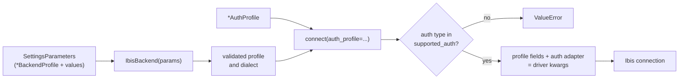

# Connection profiles and authentication

A connection profile is a typed, validated description of how to reach one database: host, port, database name, SSL mode and the other options that database's driver accepts. Each of the 20 supported backends has a `*BackendProfile` class, such as `PostgreSQLBackendProfile`, `SnowflakeBackendProfile` or `SQLiteBackendProfile`, in `mountainash_data.core.settings`. Profiles hold configuration only. Credentials live in separate auth profiles (`PasswordAuthProfile`, `TokenAuthProfile`, `IAMAuthProfile` and others) and are handed to `IbisBackend.connect()`, which combines the two into driver arguments at the moment it connects.

<!-- concept:67 -->
## BackendProfile and SettingsParameters

`BackendProfile` is the base class of every per-backend profile. It is a subclass of the `Profile` class from [`mountainash-settings`](https://docs.mountainash.io/mountainash-settings/), which is itself a pydantic-settings model, so a profile's fields are validated pydantic fields that can also be filled from environment variables, configuration files and secret stores. Field names are upper case and match the database's own vocabulary: `HOST`, `PORT`, `DATABASE`, `SCHEMA` and `SSL_MODE` for PostgreSQL; `ACCOUNT`, `WAREHOUSE` and `ROLE` for Snowflake; `PROJECT_ID` and `DATASET_ID` for BigQuery.

`BackendProfile` adds no authentication methods. It does add `to_url_parts()`, which returns a credential-free URL skeleton (scheme, host, port, database) built from the profile's fields, and raises `NotImplementedError` for a backend with no URL form. The class itself is not used directly; each backend's subclass declares its fields through a spec, described in the next section.

<!-- concept:104 -->
`IbisBackend` takes a profile in the form of a `SettingsParameters` object from `mountainash-settings`. `SettingsParameters.create()` names the profile class and supplies field values as keyword arguments; it can also name configuration files, an environment-variable prefix or a secret store, which `mountainash-settings` resolves. Passing the result to `IbisBackend` materialises and validates the profile, then picks the dialect from the profile's spec:

```python
from mountainash_settings import SettingsParameters

from mountainash_data import IbisBackend
from mountainash_data.core.settings import NoAuthProfile, SQLiteBackendProfile

params = SettingsParameters.create(
    settings_class=SQLiteBackendProfile,
    DATABASE=":memory:",
)
backend = IbisBackend(params)
print(backend.dialect)
backend.connect(auth_profile=NoAuthProfile())
print(backend.list_tables())
backend.close()
```

```text
sqlite
[]
```

Validation happens when `IbisBackend` is constructed, before any connection is attempted. A profile with field validators, such as Redshift's check on the AWS region, fails there:

```python
from pydantic import ValidationError
from mountainash_settings import SettingsParameters

from mountainash_data import IbisBackend
from mountainash_data.core.settings import RedshiftBackendProfile

params = SettingsParameters.create(
    settings_class=RedshiftBackendProfile,
    HOST="cluster.example", DATABASE="dev", REGION="sydney",
)
try:
    IbisBackend(params)
except ValidationError as exc:
    print(exc.errors()[0]["msg"])
```

```text
Value error, Invalid AWS region: sydney
```

`IbisBackend` accepts the `SettingsParameters` object, not a profile instance; passing anything other than `SettingsParameters` or a string raises `TypeError`. Keyword arguments given next to the parameters, as in `IbisBackend(params, connect_timeout=5)`, override the driver arguments the profile produces. How values are loaded from files, environments and secret stores, and how a secret store's lifetime is managed, is documented in [`mountainash-settings`](https://docs.mountainash.io/mountainash-settings/).

<!-- concept:69 -->
## BackendSpec, ParameterSpec and parameter tiers

Each profile class carries a `BackendSpec` in its `__spec__` attribute. The spec is a frozen dataclass that declares everything the package needs to know about the backend; the profile's pydantic fields are generated from it. `get_descriptor(name)` returns the spec for a registered backend:

```python
from mountainash_data.core.settings import get_descriptor

spec = get_descriptor("postgresql")
print(spec.name, spec.ibis_dialect, spec.default_port, spec.connection_string_scheme)
print([auth.__name__ for auth in spec.supported_auth])

for param in get_descriptor("duckdb").parameters:
    print(f"{param.name:<13} {param.tier:<9} default={param.default!r:<6} driver_key={param.driver_key}")
```

```text
postgresql postgres 5432 postgresql://
['PasswordAuthProfile', 'NoAuthProfile']
DATABASE      core      default=None   driver_key=database
READ_ONLY     core      default=False  driver_key=read_only
EXTENSIONS    core      default=[]     driver_key=extensions
THREADS       advanced  default=None   driver_key=None
MEMORY_LIMIT  advanced  default=None   driver_key=None
```

`BackendSpec` extends the generic `ProfileSpec` from `mountainash-settings` with database fields:

| Field | Meaning |
|---|---|
| `name` | Registry name, such as `"postgresql"` |
| `provider_type` | The provider identifier used to select auth adapters |
| `parameters` | Ordered list of `ParameterSpec`, one per profile field |
| `ibis_dialect` | The `IbisBackend` dialect key the profile connects through, such as `"postgres"` |
| `default_port` | Default TCP port, or `None` |
| `connection_string_scheme` | URL scheme prefix such as `"postgresql://"`, or `None` when the backend has no URL form |
| `rides_on` | The backend whose Ibis path this one uses, or `None` |
| `supported_auth` | Tuple of auth profile types the backend accepts; must not be empty |

The spec also carries `resource_read_*` metadata that the `mountainash` package reads when it loads a database resource. By default it is derived from the URL scheme.

<!-- concept:70 -->
A `ParameterSpec` describes one profile field. Its attributes are the upper-case `name`; the pydantic `type`; a `tier`; a `default`, where the `MISSING` sentinel marks a required field; a `driver_key`, the keyword argument the value is emitted under; a `secret` flag that wraps the value as `SecretStr`; and optional `transform` and `validator` callables. The transform converts a value into the driver's form, for example PostgreSQL's `KEEPALIVES` boolean into `1` or `0`. A parameter with no `driver_key` is not emitted under its own name; a profile adapter may consume it instead. DuckDB's `THREADS` and `MEMORY_LIMIT` are currently validated but not passed to the driver. `ParameterSpec` itself is defined in `mountainash-settings` and re-exported here.

<!-- concept:71 -->
Every parameter is tiered `"core"` or `"advanced"`. Core parameters are the ones most connections set, such as host, port, database, schema and SSL mode. Advanced parameters are the long tail: keepalive timings, certificate paths, application names, session tuning. Both tiers are ordinary profile fields and are emitted to the driver in the same way; the tier is documentation metadata for readers and tooling, not a switch. Most of PostgreSQL's parameters, for example, are advanced.

<!-- concept:72 -->
## The settings registry and automatic registration

`DATABASES_REGISTRY` is the registry of backend profiles: a `mountainash_settings.profiles.Registry` typed to `BackendSpec` and `BackendProfile`. It maps each registry name to a spec and a profile class. Three lookups read it, all exported from `mountainash_data.core.settings`:

| Lookup | Returns |
|---|---|
| `get_descriptor(name)` | The `BackendSpec` |
| `get_settings_class(name)` | The `*BackendProfile` class |
| `REGISTRY` | A read-only mapping of name to spec, kept for older imports |

An unknown name raises `KeyError` listing the known names. Registry names follow the settings vocabulary, which differs from the dialect keys in two places: the PostgreSQL profile is registered as `postgresql` (its dialect is `postgres`), and MotherDuck and Redshift have their own registry names but connect through another dialect (see [Rides-on backends](#rides-on-backends)).

<!-- concept:73 -->
Profiles enter the registry through the `register` decorator, `DATABASES_REGISTRY.decorator()`. Applied to a `BackendProfile` subclass, it reads the `__spec__` declared in the class body and records the class under the spec's name. It raises `TypeError` if the class is not a profile or has no class-body `__spec__`, and `ValueError` if the name is already taken:

```python
from mountainash_data.core.settings import (
    DATABASES_REGISTRY,
    BackendProfile,
    get_descriptor,
    get_settings_class,
    register,
)

print(sorted(DATABASES_REGISTRY.specs)[:6])
print(get_settings_class("postgresql").__name__)

try:
    @register
    class MySQLiteProfile(BackendProfile):
        __spec__ = get_descriptor("sqlite")
except ValueError as exc:
    print(exc)
```

```text
['bigquery', 'clickhouse', 'databricks', 'druid', 'duckdb', 'exasol']
PostgreSQLBackendProfile
Profile 'sqlite' is already registered in databases registry by mountainash_data.core.settings.sqlite.SQLiteBackendProfile
```

Writing and registering a profile for a new backend, with its auth adapters, is covered in [Extending mountainash-data](../17-extending-mountainash-data/index.md).

<!-- concept:74 -->
Registration is a side effect of import. Each backend's profile lives in its own module (`mountainash_data/core/settings/postgresql.py` and so on), and the `mountainash_data.core.settings` package imports all 20 modules. Importing `mountainash_data.core.settings`, or anything inside it, therefore registers every backend. `import mountainash_data` does so too, because `IbisBackend` depends on the settings package. Code never calls a registration function and never maintains a list of backends: a profile is available once its module has been imported. The same rule applies to a profile defined outside the package. Its module must be imported before its name is looked up.

<!-- concept:147 -->
## Rides-on backends

Two backends have no Ibis backend of their own and connect through another one. MotherDuck rides on DuckDB, and Redshift rides on PostgreSQL. Their specs record this in `rides_on` and set `ibis_dialect` to the underlying dialect, so a settings-built backend resolves to that dialect:

```python
from mountainash_settings import SettingsParameters

from mountainash_data import IbisBackend
from mountainash_data.core.settings import (
    MotherDuckBackendProfile,
    RedshiftBackendProfile,
    get_descriptor,
)

for name in ("motherduck", "redshift"):
    spec = get_descriptor(name)
    print(name, spec.rides_on, spec.ibis_dialect)

md = SettingsParameters.create(settings_class=MotherDuckBackendProfile, DATABASE="analytics")
rs = SettingsParameters.create(
    settings_class=RedshiftBackendProfile,
    HOST="cluster.example", DATABASE="dev", REGION="ap-southeast-2",
)
print(IbisBackend(md).dialect, IbisBackend(rs).dialect)
```

```text
motherduck duckdb duckdb
redshift postgres postgres
duckdb postgres
```

The profile still decides what is sent: the MotherDuck and Redshift profiles have their own fields, URL schemes and auth adapters (a MotherDuck token, Redshift IAM credentials), and those shape the driver arguments before the underlying dialect connects. `rides_on` itself is metadata; nothing dispatches on it. The dialect registry also has its own `motherduck` and `redshift` entries, reached with `dialect="motherduck"` or `dialect="redshift"` (and, for MotherDuck, a `duckdb://md:` URL); see [Installing and connecting](../02-installing-and-connecting/index.md). Per-dialect operation support for these entries is listed in [Supported databases and limits](../13-supported-databases-and-limits/index.md).

## Backend profile reference

<!-- concept:75 -->
<!-- concept:76 -->
<!-- concept:77 -->
<!-- concept:78 -->
<!-- concept:79 -->
<!-- concept:80 -->
<!-- concept:81 -->
<!-- concept:82 -->
<!-- concept:83 -->
<!-- concept:84 -->
All 20 profile classes are exported from `mountainash_data.core.settings`. The table is derived from each class's `BackendSpec`. "Required" lists the fields with no default. Auth types are abbreviated: `Password` is `PasswordAuthProfile`, `NoAuth` is `NoAuthProfile`, and so on.

| Registry name | Profile class | Ibis dialect | Default port | URL scheme | Required | Supported auth |
|---|---|---|---|---|---|---|
| `bigquery` | `BigQueryBackendProfile` | `bigquery` | none | `bigquery://` | `PROJECT_ID` | ServiceAccount, NoAuth |
| `clickhouse` | `ClickHouseBackendProfile` | `clickhouse` | 9000 | `clickhouse://` | `HOST` | Password, NoAuth |
| `databricks` | `DatabricksBackendProfile` | `databricks` | none | none | `SERVER_HOSTNAME`, `HTTP_PATH` | Token, Password, NoAuth |
| `druid` | `DruidBackendProfile` | `druid` | 8082 | `druid://` | `HOST` | Password, NoAuth |
| `duckdb` | `DuckDBBackendProfile` | `duckdb` | none | `duckdb://` | none | NoAuth |
| `exasol` | `ExasolBackendProfile` | `exasol` | 8563 | `exasol://` | `HOST` | Password |
| `impala` | `ImpalaBackendProfile` | `impala` | 21050 | `impala://` | `HOST` | Password, NoAuth |
| `materialize` | `MaterializeBackendProfile` | `materialize` | 6875 | `materialize://` | `HOST` | Password, NoAuth |
| `motherduck` | `MotherDuckBackendProfile` | `duckdb` (rides on `duckdb`) | none | `duckdb://md:` | none | Token |
| `mssql` | `MSSQLBackendProfile` | `mssql` | 1433 | `mssql://` | `HOST` | Password, Windows, AzureAD |
| `mysql` | `MySQLBackendProfile` | `mysql` | 3306 | `mysql://` | `HOST` | Password |
| `oracle` | `OracleBackendProfile` | `oracle` | 1521 | `oracle://` | `HOST` | Password |
| `postgresql` | `PostgreSQLBackendProfile` | `postgres` | 5432 | `postgresql://` | `HOST` | Password, NoAuth |
| `pyspark` | `PySparkBackendProfile` | `pyspark` | none | none | none | NoAuth |
| `redshift` | `RedshiftBackendProfile` | `postgres` (rides on `postgres`) | 5439 | `redshift://` | `HOST`, `DATABASE`, `REGION` | Password, IAM |
| `risingwave` | `RisingWaveBackendProfile` | `risingwave` | 5432 | `risingwave://` | `HOST` | Password, NoAuth |
| `singlestoredb` | `SingleStoreDBBackendProfile` | `singlestoredb` | 3306 | `singlestoredb://` | `HOST` | Password, NoAuth |
| `snowflake` | `SnowflakeBackendProfile` | `snowflake` | none | `snowflake://` | `ACCOUNT` | Password, OAuth2, Certificate, Token |
| `sqlite` | `SQLiteBackendProfile` | `sqlite` | none | `sqlite://` | none | NoAuth |
| `trino` | `TrinoBackendProfile` | `trino` | 8080 | `trino://` | `HOST`, `CATALOG` | Password, JWT, Kerberos, NoAuth |

A few profiles do more than map fields to driver keys. BigQuery validates the project ID, DuckDB the memory-limit format, and Redshift the AWS region and role ARN. The MSSQL, MySQL and Snowflake profiles reshape the driver arguments with profile adapters, for example appending a SQL Server instance name to the host, or moving Snowflake's time zone and query tag into session parameters. MotherDuck overrides `to_url_parts()` to produce its `md:` form. Several profiles define enums for constrained fields, such as `PostgresSSLMode` and `SnowflakeAuthenticator`. The complete field list for any profile is in its spec, `get_descriptor(name).parameters`.

The URL scheme column is the profile's own scheme. It is not always one that `IbisBackend` accepts as a URL: `redshift://` is not detected as a dialect, so Redshift connects through a profile or `dialect="redshift"`.

<!-- concept:105 -->
## Auth profiles

Credentials are not fields on a backend profile. They are separate pydantic models defined in [`mountainash-auth-client`](https://docs.mountainash.io/mountainash-auth-client/) and re-exported from `mountainash_data.core.settings`, together with the `AuthProfile` union type that covers them. Keeping them apart means the same backend profile can be used with different credentials, a configuration file can describe a database without containing a secret, and one auth profile can be reused for several backends. Secret fields are `SecretStr` and print masked:

```python
from mountainash_settings import SettingsParameters

from mountainash_data import IbisBackend
from mountainash_data.core.settings import PasswordAuthProfile, SQLiteBackendProfile

auth = PasswordAuthProfile(USERNAME="app", PASSWORD="s3cret")
print(auth.USERNAME, auth.PASSWORD)

params = SettingsParameters.create(settings_class=SQLiteBackendProfile, DATABASE=":memory:")
try:
    IbisBackend(params).connect(auth_profile=auth)
except ValueError as exc:
    print(exc)

try:
    IbisBackend(dialect="sqlite", database=":memory:").connect(auth_profile=auth)
except ValueError as exc:
    print(exc)
```

```text
app **********
sqlite does not support auth: PasswordAuthProfile
CONST_DB_PROVIDER_TYPE.SQLITE: no auth adapter for PasswordAuthProfile
```

The second and third results show the two checks an auth profile passes through, explained in [Connect-time composition](#connect-time-composition). How credentials are obtained in the first place (OAuth authorisation flows, token refresh, credential persistence) is the business of `mountainash-auth-client`; this package only consumes the resulting profile.

<!-- concept:91 -->
<!-- concept:92 -->
<!-- concept:93 -->
<!-- concept:94 -->
The package re-exports eleven concrete auth types. The table lists each type's fields and the backends whose profiles accept it:

| Auth profile | Fields | Accepted by |
|---|---|---|
| `NoAuthProfile` | none | bigquery, clickhouse, databricks, druid, duckdb, impala, materialize, postgresql, pyspark, risingwave, singlestoredb, sqlite, trino |
| `PasswordAuthProfile` | `USERNAME`, `PASSWORD` | clickhouse, databricks, druid, exasol, impala, materialize, mssql, mysql, oracle, postgresql, redshift, risingwave, singlestoredb, snowflake, trino |
| `TokenAuthProfile` | `TOKEN` | databricks, motherduck, snowflake |
| `JWTAuthProfile` | `TOKEN` | trino |
| `OAuth2AuthProfile` | `CLIENT_ID`, `CLIENT_SECRET`, `ACCESS_TOKEN`, `REFRESH_TOKEN`, `SCOPE` | snowflake |
| `IAMAuthProfile` | `ROLE_ARN`, `ACCESS_KEY_ID`, `SECRET_ACCESS_KEY`, `SESSION_TOKEN`, `PROFILE_NAME` | redshift |
| `WindowsAuthProfile` | `USERNAME`, `DOMAIN` | mssql |
| `AzureADAuthProfile` | `TENANT_ID`, `CLIENT_ID`, `CLIENT_SECRET`, `MANAGED_IDENTITY`, `MSI_ENDPOINT` | mssql |
| `KerberosAuthProfile` | `SERVICE_NAME`, `PRINCIPAL`, `KEYTAB` | trino |
| `CertificateAuthProfile` | `PRIVATE_KEY`, `PRIVATE_KEY_PATH`, `PASSPHRASE` | snowflake |
| `ServiceAccountAuthProfile` | `INFO`, `FILE` | bigquery |

`NoAuthProfile` carries nothing and means "connect without package-supplied credentials". It is the right choice for file and in-process databases, and for servers that authenticate the process some other way. `PasswordAuthProfile` is the common case for SQL servers: for the flat user-and-password backends it becomes the driver's `user` and `password` arguments, while Snowflake, Databricks, Trino, SQL Server and Redshift have their own adapters for it. `TokenAuthProfile` holds one bearer secret, used as a MotherDuck token, a Databricks access token or a Snowflake token. `IAMAuthProfile` is Redshift's AWS identity route: every field is optional, so it can name a role ARN, explicit keys, a session token or a named AWS profile, and the adapter enables IAM authentication and passes only the fields that are set.

<!-- concept:106 -->
## Connect-time composition

A backend profile and an auth profile meet only inside `connect()`. Construction records the profile; `connect(auth_profile=...)` validates the pairing, renders driver arguments from both, and hands them to the dialect's Ibis connection builder:



On the settings path, the auth profile is checked against the spec's `supported_auth` first. Omitting `auth_profile` is the same as passing `NoAuthProfile()`, so a backend that does not list `NoAuthProfile` (Exasol, MySQL, Oracle, SQL Server, Redshift, Snowflake, MotherDuck) raises `ValueError` when connected without credentials (once its driver extra is installed, since the driver import comes first). A supported type is then applied by the auth adapter registered for that backend and auth type, which adds the credential arguments to the profile's emitted driver arguments. The result is a plain keyword dictionary passed to Ibis; the steps are traced in [From settings to driver arguments](../15-from-settings-to-driver-arguments/index.md).

The dialect-keyword and URL forms of `IbisBackend` accept `connect(auth_profile=...)` too, but they have no profile and so no `supported_auth` check. The auth profile goes straight to the adapter for the dialect (or for the URL scheme), and a combination with no adapter raises the `no auth adapter` `ValueError` shown above. `NoAuthProfile` on these paths adds nothing. In every form, credentials are applied only at connect time, and the backend's configuration before `connect()` holds no secrets.
