# Configuring connections with mountainash-settings

Every backend profile in this package is a [`mountainash-settings`](https://github.com/mountainash-io/mountainash-settings) settings class, so a connection can be described by deployment sources instead of code: YAML, TOML, JSON and dotenv files, prefixed environment variables, and `secret:` references resolved from a secret store. A `SettingsParameters` object records which sources to read for which profile. Passed to `IbisBackend`, it is resolved into a validated profile; at `connect()` the profile is combined with a separately supplied auth profile from [`mountainash-auth-client`](https://github.com/mountainash-io/mountainash-auth-client) and turned into driver arguments. A `SettingsParameters` object without a bound secret store is small and picklable, and its printed form holds no credentials, so it can be handed to a thread, a process or an orchestrator step and resolved where the connection is opened. This is the configuration step of the ecosystem workflow: settings become a live connection here, before tables are handed to `mountainash` expressions or written back.

```mermaid
flowchart LR
  files["config files<br/>YAML, TOML, JSON, .env"] --> recipe
  env["environment<br/>(env_prefix)"] --> recipe
  store["secret store<br/>(secret: references)"] --> recipe
  recipe["SettingsParameters<br/>(*BackendProfile recipe)"] --> ctor["IbisBackend(params)<br/>validated profile"]
  authsrc["*AuthProfile<br/>(mountainash-auth-client)"] --> connect
  ctor --> connect["connect(auth_profile=...)"]
  connect --> driver["driver kwargs<br/>Ibis connection"]
```



The profile classes, the auth profiles and the `supported_auth` check are described in [Connection profiles and authentication](../03-connection-profiles-and-authentication/index.md). How a resolved profile and an auth profile become driver keyword arguments is traced in [From settings to driver arguments](../15-from-settings-to-driver-arguments/index.md). The full source, caching and secret-store API belongs to `mountainash-settings`; its README and `examples/` directory on [GitHub](https://github.com/mountainash-io/mountainash-settings) are the reference.

The examples below run from a working directory holding a `config/` folder. Each file's content is shown before the example that reads it.

<!-- concept:159 -->
## Configuration file sources

`SettingsParameters.create()` takes a `settings_class` (any `*BackendProfile`) and a `config_files` list. Files are recognised by extension: `.yaml` or `.yml`, `.toml`, `.json`, and dotenv files named `.env` or ending in `.env`. Each file supplies values for the profile's upper-case fields, so a DuckDB deployment can be split across three files:

`config/warehouse.yaml`:

```yaml
DATABASE: warehouse.duckdb
EXTENSIONS:
  - parquet
```

`config/warehouse.toml`:

```toml
DATABASE = "toml_reports.duckdb"
READ_ONLY = false
```

`config/warehouse.json`:

```json
{"THREADS": 2}
```

```python
from mountainash_settings import SettingsParameters

from mountainash_data import IbisBackend
from mountainash_data.core.settings import DuckDBBackendProfile

params = SettingsParameters.create(
    settings_class=DuckDBBackendProfile,
    config_files=[
        "config/warehouse.yaml",
        "config/warehouse.toml",
        "config/warehouse.json",
    ],
    env_prefix="REPORTS_DB_",
)
profile = params.get_settings()
print(profile.DATABASE, profile.READ_ONLY, profile.EXTENSIONS, profile.THREADS)

backend = IbisBackend(params).connect()
print(backend.dialect)
print(backend.raw_driver_connection().execute(
    "SELECT loaded FROM duckdb_extensions() WHERE extension_name = 'parquet'"
).fetchone())
backend.close()
```

```text
warehouse.duckdb False ['parquet'] 2
duckdb
(True,)
```

`params.get_settings()` shows the profile the files produce; `IbisBackend(params)` resolves the same profile, picks the dialect from the profile class, and opens the database at `connect()`. The `parquet` extension listed in YAML reached the DuckDB driver and is loaded.

Two things in that output come from `mountainash-settings` rules rather than file order. `DATABASE` is set by both the YAML and the TOML file, and YAML wins even though TOML is listed later: across formats the priority is fixed (YAML, then TOML, then JSON), and only files of the same format merge in list order, recursively for mappings. And `THREADS` is validated and stored on the profile but is not passed to DuckDB. At this source revision the DuckDB profile emits only `DATABASE`, `READ_ONLY` and `EXTENSIONS` as driver arguments; `THREADS` and `MEMORY_LIMIT` have no driver key (`src/mountainash_data/core/settings/duckdb.py`). Pass them as driver keyword arguments instead, as in the next section.

A backend profile class is itself a settings class, so it also accepts `config_files=` and `env_prefix=` directly. That is useful for checking what a file produces, for example the driver arguments of a PostgreSQL profile that cannot be connected here:

`config/postgres.yaml`:

```yaml
HOST: db.internal.example
DATABASE: reports
SSL_MODE: require
CONNECT_TIMEOUT: 10
APPLICATION_NAME: nightly-reports
```

```python
from mountainash_data import IbisBackend
from mountainash_data.core.factories.connection_factory import build_driver_kwargs
from mountainash_data.core.settings import PostgreSQLBackendProfile

profile = PostgreSQLBackendProfile(
    config_files=["config/postgres.yaml"], env_prefix="REPORTS_PG_",
)
print(build_driver_kwargs(profile))

try:
    IbisBackend(profile)
except TypeError as exc:
    print(exc)
```

```text
{'host': 'db.internal.example', 'port': 5432, 'database': 'reports', 'autocommit': True, 'connect_timeout': 10, 'application_name': 'nightly-reports', 'keepalives': 1, 'sslmode': <PostgresSSLMode.REQUIRE: 'require'>}
Expected SettingsParameters or str, got PostgreSQLBackendProfile
```

`IbisBackend` does not take a profile instance. It takes the `SettingsParameters` recipe (or a URL or dialect name), so the settings path always starts from sources and resolves them itself.

<!-- concept:160 -->
## Environment prefix overrides

`env_prefix=` names the prefix under which environment variables and dotenv entries fill profile fields: with `env_prefix="REPORTS_DB_"`, the variable `REPORTS_DB_DATABASE` sets `DATABASE`. Always give a recipe a prefix. Without one, field names are read from the environment unprefixed, and an ambient variable such as `USERNAME` (set by most login shells) silently fills the `USERNAME` field of a `PasswordAuthProfile` and overrides the value in its config file.

A dotenv file uses the same prefix. `config/.env`:

```text
REPORTS_DB_DATABASE=dotenv.duckdb
```

```python
from mountainash_settings import SettingsParameters

from mountainash_data import IbisBackend
from mountainash_data.core.settings import DuckDBBackendProfile

params = SettingsParameters.create(
    settings_class=DuckDBBackendProfile,
    config_files=["config/warehouse.yaml", "config/.env"],
    env_prefix="REPORTS_DB_",
)
print(params.get_settings().DATABASE)
print(params.get_settings(DATABASE="scratch.duckdb").DATABASE)

backend = IbisBackend(params, threads=1).connect()
print(backend.raw_driver_connection().execute(
    "SELECT current_database(), current_setting('threads')"
).fetchone())
backend.close()
```

Run as is, and then with the variable set in the process environment:

```text
$ python env_override.py
dotenv.duckdb
scratch.duckdb
('dotenv', 1)

$ REPORTS_DB_DATABASE=:memory: python env_override.py
:memory:
scratch.duckdb
('memory', 1)
```

The dotenv value beats the YAML file's `warehouse.duckdb`, the OS environment beats the dotenv file, and a value passed to `get_settings()` beats both. The full order, from the `mountainash-settings` [source precedence example](https://github.com/mountainash-io/mountainash-settings/tree/develop/examples/source_precedence), highest first:

| Priority | Source |
|---|---|
| 1 | Values passed in code (`SettingsParameters.create(..., DATABASE=...)` or `get_settings(DATABASE=...)`) |
| 2 | OS environment variables with the prefix |
| 3 | Prefixed dotenv entries |
| 4 | Unprefixed dotenv entries |
| 5 | YAML files |
| 6 | TOML files |
| 7 | JSON files |
| 8 | Pydantic secret files (`secrets_dir`) |
| 9 | Field defaults |

`IbisBackend` adds one layer on top of the resolved profile. Keyword arguments given to the constructor next to the recipe, here `threads=1`, are merged over the driver arguments the profile emits, so they win over every settings source. This is also how to reach a driver option the profile does not emit, such as DuckDB's `threads`.

Source inputs are captured once per process for each combination of settings class, `config_files`, `env_prefix`, `secrets_dir` and secret store. A later recipe with the same selectors reuses that capture, so changing `os.environ` after the first resolution has no effect in that process; a new process reads the current environment. Values passed in code are not part of the capture and apply to each call separately.

<!-- concept:161 -->
## Secret references

A field value that starts with `secret:` is not used literally. It is resolved from the secret store selected on the recipe with `secret_store=`, while the profile is built. In `secret:postgres.password` the text before the last dot names the record (`postgres`) and the text after it names the field (`password`). The configuration file can then be committed, because it holds a reference instead of the password.

Backend profiles carry no credentials, so references usually appear in the auth profile. Auth profiles from `mountainash-auth-client` are `mountainash-settings` classes too, and load from the same kinds of source:

`config/postgres-auth.yaml`:

```yaml
USERNAME: report_user
PASSWORD: secret:postgres.password
```

```python
from mountainash_settings import SettingsParameters
from mountainash_settings.secrets import MemorySecretStore, NamespacedSecretStore

from mountainash_data.core.factories.connection_factory import build_driver_kwargs
from mountainash_data.core.settings import PasswordAuthProfile, PostgreSQLBackendProfile

records = NamespacedSecretStore(MemorySecretStore(), "reports_app")
with records.transaction("postgres"):
    records.set("postgres", {"password": "example-password"})

auth = SettingsParameters.create(
    settings_class=PasswordAuthProfile,
    config_files=["config/postgres-auth.yaml"],
    env_prefix="REPORTS_PG_",
    secret_store=records,
).get_settings()
print(auth.USERNAME, auth.PASSWORD)

profile = PostgreSQLBackendProfile(
    config_files=["config/postgres.yaml"], env_prefix="REPORTS_PG_",
)
kwargs = build_driver_kwargs(profile, auth)
print(sorted(kwargs))
print(kwargs["password"] == "example-password")

try:
    SettingsParameters.create(
        settings_class=PasswordAuthProfile,
        config_files=["config/postgres-auth.yaml"],
        env_prefix="REPORTS_PG_",
    ).get_settings()
except Exception as exc:
    print(type(exc).__name__, exc)
```

```text
report_user **********
['application_name', 'autocommit', 'connect_timeout', 'database', 'host', 'keepalives', 'password', 'port', 'sslmode', 'user']
True
SecretCapabilityError No secret store selected
```

The resolved password is a `SecretStr` and prints masked. It is unwrapped only when the auth adapter builds driver arguments, which is what `IbisBackend(params).connect(auth_profile=auth)` does with a live PostgreSQL server; the dict that `build_driver_kwargs()` returns holds the plain secret and is meant for the driver, not a log. A reference with no store selected fails with a value-free `SecretCapabilityError` rather than passing the literal `secret:` text to the driver.

The two packages divide the work. `mountainash-settings` owns the reference syntax and the stores: `MemorySecretStore` for tests and ephemeral use, `FilesystemBackend` for a hardened on-disk record store, and `NamespacedSecretStore` for a prefixed view over either. The application creates the store and owns its lifetime. `mountainash-auth-client` owns the auth profile types and any flow that obtains a token. This package checks that the auth type is one the backend supports and applies it at `connect()`, so neither the backend recipe nor the `IbisBackend` before `connect()` holds a resolved secret. Cloud secret managers are not part of `mountainash_settings.secrets`; see its [secrets guide](https://github.com/mountainash-io/mountainash-settings/blob/develop/docs/README_SECRETS.md).

<!-- concept:162 -->
## Settings recipes across workers

A resolved profile, or a settings cache warmed at startup, belongs to the process that built it. A worker started with `spawn` or `forkserver`, or a Dagster step running in its own process, imports the application afresh and has neither. `SettingsParameters` is the recipe for rebuilding them: the settings class and the source selectors, plus any values passed in code. Hand the recipe to the worker and construct `IbisBackend(params)` there, so the connection is opened in the process that uses it:

```python
import multiprocessing as mp
import os
from concurrent.futures import ProcessPoolExecutor
from pathlib import Path

import polars as pl
from mountainash_settings import SettingsParameters

from mountainash_data import IbisBackend
from mountainash_data.core.settings import DuckDBBackendProfile


def count_region(params: SettingsParameters, region: str) -> tuple[str, int, int]:
    with IbisBackend(params, read_only=True).connect() as backend:
        sales = backend.table("sales")
        return region, sales.filter(sales.region == region).count().execute(), os.getpid()


if __name__ == "__main__":
    params = SettingsParameters.create(
        settings_class=DuckDBBackendProfile,
        config_files=[Path("config/warehouse.yaml").resolve()],
        env_prefix="REPORTS_DB_",
    )
    with IbisBackend(params).connect() as backend:
        backend.create_table(
            "sales",
            pl.DataFrame({"region": ["n", "n", "s"], "total": [120, 80, 95]}),
            overwrite=True,
        )

    with ProcessPoolExecutor(2, mp_context=mp.get_context("spawn")) as pool:
        for region, count, pid in pool.map(count_region, [params, params], ["n", "s"]):
            print(region, count, pid != os.getpid())
```

```text
n 2 True
s 1 True
```

Each spawned worker unpickles the recipe, reads `config/warehouse.yaml` itself and opens its own read-only DuckDB connection; `read_only=True` is a driver keyword argument layered over the profile, as in the previous section. Connections are never passed between processes. The config path is resolved to an absolute path before it travels, because a worker may start in a different working directory; a relative value inside the file, such as `DATABASE: warehouse.duckdb`, is still interpreted against the worker's own directory. A worker also reads its own environment, so a prefixed variable set for the worker applies there. The `mountainash-settings` [execution boundaries example](https://github.com/mountainash-io/mountainash-settings/tree/develop/examples/execution_boundaries) measures this for threads and for the `spawn`, `fork` and `forkserver` start methods, and the [Dagster workers example](https://github.com/mountainash-io/mountainash-settings/tree/develop/examples/dagster_workers) shows the same pattern with source selectors carried in resource configuration and the recipe built inside resource initialisation.

Holding a recipe instead of a resolved profile also keeps credentials out of an object's printed form. `SettingsParameters` leaves the values passed in code and the selected secret store out of its `repr`, so a job object that stores recipes can be logged:

```python
from dataclasses import dataclass

from mountainash_settings import SettingsParameters

from mountainash_data.core.factories.connection_factory import build_driver_kwargs
from mountainash_data.core.settings import PasswordAuthProfile, PostgreSQLBackendProfile


@dataclass
class NightlyReport:
    database: SettingsParameters
    credentials: SettingsParameters

    def driver_kwargs(self) -> dict:
        # Resolved inside the task; nothing resolved is stored on self.
        return build_driver_kwargs(
            self.database.get_settings(), self.credentials.get_settings()
        )


job = NightlyReport(
    database=SettingsParameters.create(
        settings_class=PostgreSQLBackendProfile, env_prefix="REPORTS_PG_",
        HOST="db.internal.example", DATABASE="reports",
    ),
    credentials=SettingsParameters.create(
        settings_class=PasswordAuthProfile, env_prefix="REPORTS_PG_",
        USERNAME="report_user", PASSWORD="example-password",
    ),
)
print(job)
print("example-password" in repr(job), "password" in job.driver_kwargs())
```

```text
NightlyReport(database=SettingsParameters(config_files=(), settings_class=<class 'mountainash_data.core.settings.postgresql.PostgreSQLBackendProfile'>, env_prefix='REPORTS_PG_', secrets_dir=None), credentials=SettingsParameters(config_files=(), settings_class=<class 'mountainash_auth_client.schemas.password.PasswordAuthProfile'>, env_prefix='REPORTS_PG_', secrets_dir=None))
False True
```

The recipe's printed form shows only the class and source selectors, yet the task still resolves the password when it builds driver arguments. This protects against accidental logging only. `params.kwargs` still holds a password passed in code, and a resolved profile with a plain-string field prints its value, so prefer a `secret:` reference or a file selector to an inline password, and keep resolved profiles local to the task. The `mountainash-settings` [orchestrator credentials example](https://github.com/mountainash-io/mountainash-settings/tree/develop/examples/orchestrator_credentials) sets out what the recipe does and does not hide. A recipe that carries a secret store does not travel to another process: pickling one built with `MemorySecretStore` fails with `TypeError: cannot pickle '_thread.lock' object`. Send the store-free selectors instead, and let the worker open its own store, for example a `FilesystemBackend` over a directory provisioned for that worker, and pass it as `secret_store=` when it builds the recipe.
