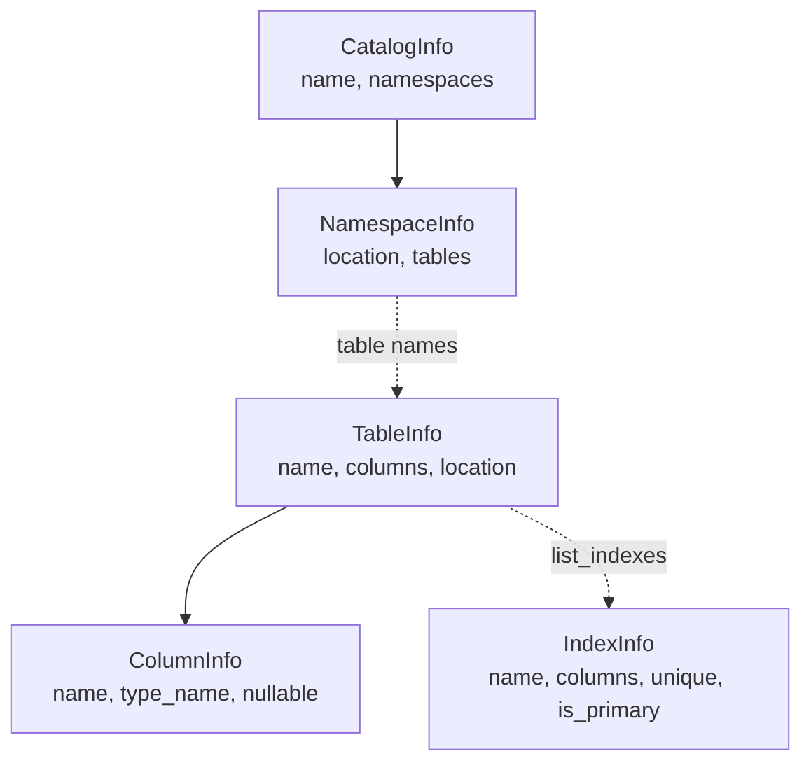

# Inspecting databases

Inspection answers "what is in this database?" without reading any rows. A connected backend lists its catalogs, namespaces and tables, and describes a table's columns, a namespace's tables or a whole catalog as frozen dataclasses with the same shape on every dialect. This is physical metadata that mountainash relations do not own: a relation describes a computation over a table ([Running mountainash expressions against databases](../07-running-mountainash-expressions-against-databases/index.md)), while inspection describes the tables, namespaces and catalogs as they exist in the database.

All examples use an in-memory DuckDB or SQLite backend, as set up in [Installing and connecting](../02-installing-and-connecting/index.md).

## The inspection methods

<!-- concept:14 -->
<!-- concept:15 -->
Tables are listed with `list_tables(namespace=None)`, which returns a plain `list[str]` of table names in the connection's default namespace or in the one you name. `inspect_table(name, namespace=None)` returns a `TableInfo` for one table: its name, its columns and the location you asked for. A table that cannot be read raises `ValueError` with the table name in the message.

<!-- concept:16 -->
<!-- concept:17 -->
Namespaces are the schema, database or dataset level that holds tables. `list_namespaces(catalog=None)` returns their names, optionally within one catalog. `inspect_namespace(name)` returns a `NamespaceInfo` holding the namespace's location and the names of the tables inside it.

<!-- concept:18 -->
Catalogs sit above namespaces. `list_catalogs()` returns the catalog names a connection can see, and `inspect_catalog(catalog=None)` returns a `CatalogInfo` that bundles every namespace in the catalog, each with its table names. Passing a catalog name scopes the walk to that catalog; with no name, the catalog takes the dialect's backend name and the namespaces come from the connection's default listing. Engines with no catalog concept still answer: SQLite reports a single pseudo-catalog named `sqlite`.

```python
from mountainash_data import IbisBackend

rows = [{"id": 1, "region": "north", "total": 120}]

with IbisBackend(dialect="duckdb", database=":memory:") as backend:
    backend.create_table("sales", rows)
    print(backend.list_catalogs())
    print(backend.list_namespaces())
    print(backend.list_tables())
    info = backend.inspect_table("sales")
    print(info.qualified_name, info.column_names)
    ns = backend.inspect_namespace("main")
    print(ns.name, ns.tables)
    catalog = backend.inspect_catalog("memory")
    print(catalog.name, [(n.location.dotted, list(n.tables)) for n in catalog.namespaces])
```

```text
['memory', 'system', 'temp']
['information_schema', 'main', 'pg_catalog']
['sales']
sales ['id', 'region', 'total']
main ['sales']
memory [('memory.main', ['sales'])]
```

The three `list_*` methods degrade rather than fail outside a transaction: if the engine rejects the listing, they print the error and return an empty list. Inside a [`transaction()`](../10-transactions/index.md) scope they raise instead, because a failed query there is not the same as "nothing found".

## Namespace and NamespaceLike

<!-- concept:110 -->
`Namespace` is the package's backend-agnostic answer to "where does this table live?". It is a frozen dataclass with two named fields, so nothing is inferred from tuple position:

| Field | Type | Meaning |
|---|---|---|
| `path` | `tuple[str, ...]` | The schema or namespace levels between the catalog and the table. Empty means the connection's default. |
| `catalog` | `str` or `None` | The top-level catalog, always explicit. `None` means the connection's current catalog. |

Every path segment must be a non-empty string; anything else raises `ValueError` when the object is built. Two read-only properties help with display and checks: `dotted` joins catalog and path with dots (for messages and logging, not for SQL), and `is_default` is `True` when both fields are empty. `Namespace` does not render itself into SQL. Each backend translates it at its own boundary, which is where the limits described in [Supported databases and limits](../13-supported-databases-and-limits/index.md) are enforced.

<!-- concept:111 -->
Every method that takes a `namespace=` argument accepts a `NamespaceLike`: a `Namespace`, a plain string, a tuple of strings, or `None`. The package coerces it with `Namespace.coerce()`, so the short forms are equivalent to the explicit one:

```python
from mountainash_data import Namespace

print(Namespace.coerce(None))
print(Namespace.coerce("analytics"))
print(Namespace.coerce(("analytics",)))
print(Namespace.coerce(Namespace(catalog="warehouse", path=("analytics",))))
loc = Namespace(catalog="warehouse", path=("analytics",))
print(loc.dotted, loc.is_default, Namespace().is_default)
try:
    Namespace(path=("",))
except ValueError as exc:
    print(f"ValueError: {exc}")
try:
    Namespace.coerce(42)
except TypeError as exc:
    print(f"TypeError: {exc}")
```

```text
Namespace(path=(), catalog=None)
Namespace(path=('analytics',), catalog=None)
Namespace(path=('analytics',), catalog=None)
Namespace(path=('analytics',), catalog='warehouse')
warehouse.analytics False True
ValueError: Namespace.path segments must be non-empty strings: ('',)
TypeError: Cannot coerce 42 to Namespace
```

A string or tuple only ever fills `path`. To name a catalog, build a `Namespace` with `catalog=` explicitly.

## CatalogInfo, NamespaceInfo, TableInfo, ColumnInfo, IndexInfo

The inspection results nest the same way the database does. A catalog holds namespaces, a namespace names its tables, and a table holds columns. Indexes hang off a table but are fetched separately.



All five types are exported from the top-level package (`from mountainash_data import TableInfo`, and so on). Each carries a `metadata` mapping, empty by default, for backend-specific extras.

<!-- concept:49 -->
### CatalogInfo

`CatalogInfo` describes a top-level catalog or backend instance. It has a `name` and a sequence of `NamespaceInfo` objects in `namespaces`. It is what `inspect_catalog()` returns, and it is the only result that contains other results rather than names: walking `catalog.namespaces` gives the full catalog-to-table map in one call. On a server database that call issues one table listing per namespace, so scope it with a catalog name on large warehouses. The SQLite catalog below shows the pseudo-catalog name and the two namespaces SQLite always reports:

```python
from mountainash_data import IbisBackend

with IbisBackend(dialect="sqlite", database=":memory:") as backend:
    backend.create_table("sales", [{"id": 1}])
    print(backend.list_catalogs())
    print(backend.list_namespaces())
    catalog = backend.inspect_catalog()
    print(catalog.name)
    for ns in catalog.namespaces:
        print(ns.location, ns.tables)
```

```text
['sqlite']
['main', 'temp']
sqlite
Namespace(path=('main',), catalog=None) ['sales']
Namespace(path=('temp',), catalog=None) []
```

<!-- concept:50 -->
### NamespaceInfo

`NamespaceInfo` describes one namespace (a schema, database or dataset, depending on the engine). Its `location` is a `Namespace`, and `tables` is a sequence of table names, not `TableInfo` objects, so inspecting a namespace never reads column metadata. The `name` property returns the last segment of `location.path`, or an empty string for the default namespace. `inspect_namespace("main")` sets `location` to `Namespace(path=("main",))`; namespaces reached through `inspect_catalog("memory")` also carry the catalog, which is why `location.dotted` printed `memory.main` in the first example.

<!-- concept:51 -->
### TableInfo

`TableInfo` describes one table or view:

| Field or property | Contents |
|---|---|
| `name` | The table name. |
| `columns` | A sequence of `ColumnInfo`, in table order. |
| `location` | The `Namespace` the table was inspected in. Defaults to `Namespace()`. |
| `description` | Optional free text. `None` from the Ibis backend. |
| `metadata` | Backend extras. Empty from the Ibis backend. |
| `column_names` | Property: the column names as a list. |
| `qualified_name` | Property: `location.dotted` and `name` joined with dots, for display. |

`location` echoes what you passed rather than what the engine resolved. `inspect_table("sales")` yields `Namespace()` and a `qualified_name` of `sales`; pass a namespace when you want it recorded.

<!-- concept:52 -->
### ColumnInfo

`ColumnInfo` describes one column with `name`, `type_name`, `nullable`, an optional `description` and `metadata`. `type_name` is the Ibis type rendered as a string (`int64`, `string`, `timestamp`), not the engine's native type name, so the same table reports the same types on DuckDB and PostgreSQL. `nullable` comes from the Ibis type as well.

```python
import dataclasses

from mountainash_data import IbisBackend, Namespace

with IbisBackend(dialect="duckdb", database=":memory:") as backend:
    backend.create_table("sales", [{"id": 1, "region": "north", "total": 120}])
    location = Namespace(catalog="memory", path=("main",))
    info = backend.inspect_table("sales", namespace=location)
    print(info.qualified_name)
    for column in info.columns:
        print(column)
    print(info.location == location)
    try:
        info.name = "renamed"
    except dataclasses.FrozenInstanceError as exc:
        print(f"FrozenInstanceError: {exc}")
    renamed = dataclasses.replace(info, name="sales_copy")
    print(renamed.qualified_name)
```

```text
memory.main.sales
ColumnInfo(name='id', type_name='int64', nullable=True, description=None, metadata={})
ColumnInfo(name='region', type_name='string', nullable=True, description=None, metadata={})
ColumnInfo(name='total', type_name='int64', nullable=True, description=None, metadata={})
True
FrozenInstanceError: cannot assign to field 'name'
memory.main.sales_copy
```

<!-- concept:113 -->
### IndexInfo

`IndexInfo` describes one index on a table. `list_indexes(table_name, namespace=None)` returns a list of them; the method, and which dialects support it, belong to [Indexes](../09-indexes/index.md).

| Field | Contents |
|---|---|
| `name` | The index name. |
| `unique`, `is_primary` | Whether the index enforces uniqueness, and whether it backs the primary key. |
| `columns` | The indexed column names, in key order. |
| `index_type` | The access method when the engine reports one (`btree`, `hash`, ...), else `None`. |
| `included_columns` | Non-key columns carried in the index (an `INCLUDE` list on PostgreSQL or SQL Server), else empty. |
| `is_valid` | Engine-reported validity where it exists, else `None`. |
| `definition` | The index DDL when the engine exposes it, else `None`. |
| `metadata` | Backend extras. |

```python
from mountainash_data import IbisBackend

with IbisBackend(dialect="sqlite", database=":memory:") as backend:
    backend.create_table("sales", [{"id": 1, "region": "north", "total": 120}])
    backend.create_index("sales", ["region"], index_name="ix_sales_region")
    for index in backend.list_indexes("sales"):
        print(index)
```

```text
IndexInfo(name='ix_sales_region', unique=False, is_primary=False, columns=('region',), index_type='btree', included_columns=(), is_valid=None, definition='CREATE INDEX "ix_sales_region" ON "sales" ("region")', metadata={})
```

## Frozen, backend-agnostic metadata

<!-- concept:53 -->
Every inspection type, `Namespace` included, is a frozen dataclass. Assigning to a field raises `dataclasses.FrozenInstanceError`, as the `ColumnInfo` example shows, and `dataclasses.replace()` is the way to derive a modified copy. A result is a snapshot of the database at the moment of the call. It does not refresh when the table changes, and it holds no reference to the connection, so it stays valid after the backend closes and can be cached or compared with `==`. `Namespace` is hashable and works as a dictionary key; the info types are not hashable, because each holds a `metadata` mapping.

<!-- concept:54 -->
The types live in `mountainash_data.core.inspection` and `mountainash_data.core.namespace`, below any backend. They describe physical structure with no reference to Ibis, SQL or a driver: type names are portable strings and locations are `Namespace` values. Code that consumes them, such as a schema comparison or a catalog browser, works against any `Backend` implementation, including one that is not built on Ibis (see [Extending mountainash-data](../17-extending-mountainash-data/index.md)).

## How driver metadata becomes TableInfo

<!-- concept:55 -->
The Ibis backend builds a `TableInfo` from the Ibis table's schema, through the public helper `table_to_info()` in `mountainash_data.backends.ibis.inspect`. For each column in schema order it records the name, `str()` of the Ibis data type as `type_name`, and the type's nullability. It sets the location to the coerced namespace you passed and leaves `description` and `metadata` empty. The conversion itself issues no queries; the only database work is Ibis resolving the table's schema. Index metadata follows a separate path, per-dialect catalog queries, described in [Indexes](../09-indexes/index.md).

## Inspecting through IbisBackend

<!-- concept:56 -->
The six inspection methods are part of the `Backend` protocol in `mountainash_data.core.protocol`, alongside `connect()`, `close()` and the transaction members. Any backend that satisfies the protocol answers the same calls with the same result types, which is what makes the inspection API unified: callers can type against `Backend` and stay independent of the implementation. `IbisBackend` is the implementation the package ships, and it satisfies the protocol structurally:

```python
from mountainash_data import Backend, IbisBackend

backend = IbisBackend(dialect="sqlite", database=":memory:")
print(isinstance(backend, Backend))
try:
    backend.list_tables()
except RuntimeError as exc:
    print(f"RuntimeError: {exc}")
```

```text
True
RuntimeError: IbisBackend is not connected. Call connect() first.
```

Inspection needs a live connection. Each method raises `RuntimeError` until `connect()` has run or the `with` block has entered.

<!-- concept:30 -->
`IbisBackend.list_tables()` coerces the namespace and passes it to Ibis as the `database=` argument: a one-level path becomes a string, and a catalog-qualified namespace becomes a `(catalog, level)` pair. Ibis models exactly catalog, database and table, so a path with two or more levels raises `ValueError`, and so does a catalog with no path level:

```python
from mountainash_data import IbisBackend, Namespace

with IbisBackend(dialect="duckdb", database=":memory:") as backend:
    try:
        backend.inspect_table("missing")
    except ValueError as exc:
        print(f"ValueError: {str(exc).splitlines()[0]}")
    try:
        backend.list_tables(namespace=("main", "nested"))
    except ValueError as exc:
        print(f"ValueError: {exc}")
    try:
        backend.list_tables(namespace=Namespace(catalog="memory"))
    except ValueError as exc:
        print(f"ValueError: {exc}")
```

```text
ValueError: Could not inspect table 'missing': missing
ValueError: ibis backends support a single namespace level; got path=('main', 'nested'). Use Namespace(catalog=..., path=(one_level,)) to target a catalog.
ValueError: A catalog-qualified ibis namespace requires one path level.
```

<!-- concept:31 -->
`IbisBackend.inspect_table()` resolves the table through Ibis with the same rendered namespace and converts its schema as described above. Any failure, whether a missing table, a missing namespace or a permission error, is re-raised as `ValueError` naming the table, with the original exception chained as its cause.

<!-- concept:32 -->
`IbisBackend.list_namespaces()` asks Ibis for databases where the backend supports that (passing the catalog through when given) and falls back to Ibis's schema listing otherwise. `inspect_namespace(name)` takes a single-level name, lists that namespace's tables and wraps them in a `NamespaceInfo`. Because the table listing degrades outside a transaction, a namespace that does not exist usually comes back with an empty `tables` sequence rather than an error. To inspect a namespace in another catalog, use `inspect_catalog(catalog)` or `list_tables(namespace=Namespace(catalog=..., path=(...,)))`.

<!-- concept:33 -->
`IbisBackend.list_catalogs()` returns Ibis's catalog list where the backend has one. Otherwise it falls back to the connection's current catalog, and for engines with no catalog concept at all, to the dialect's Ibis backend name, so a live connection always returns at least one entry. `inspect_catalog(catalog)` lists the namespaces in that catalog and the tables in each, recording the catalog in every namespace's location. Which dialects accept catalog-qualified namespaces for which operations is covered in [Supported databases and limits](../13-supported-databases-and-limits/index.md).
