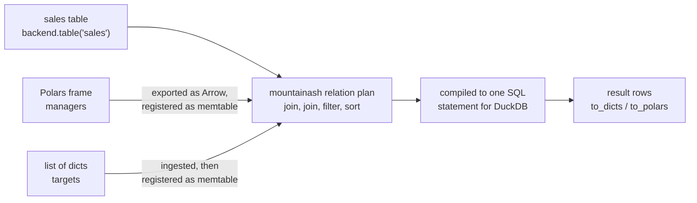

# Running mountainash expressions against databases

The [`mountainash`](https://github.com/mountainash-io/mountainash) package defines expressions, relations, schemas and data contracts once and runs them on Polars frames, Python data or SQL databases. mountainash-data supplies the database side: a connected `IbisBackend` hands its tables to `mountainash.relation()`, and from there the same `ma.col(...)` expression filters a warehouse table or a local dataframe, a database table joins with Polars frames and lists of dicts in one plan, and a `TableSchema` conforms and validates the table where it lives. This is the step between connecting (chapters 2 to 6) and writing results back ([Creating and changing tables](../08-creating-and-changing-tables/index.md)); [An end-to-end pipeline](../12-an-end-to-end-pipeline/index.md) puts the whole sequence together.

`mountainash` is a separate install with its own documentation; this page shows the integration points and links to its [README](https://github.com/mountainash-io/mountainash#readme) and [feature guides](https://github.com/mountainash-io/mountainash/tree/develop/docs/website/features-technical) for the full API.

## A mountainash relation over a backend table

<!-- concept:142 -->
The handoff is one call: `ma.relation(backend.table(name))`. `table()` returns a backend-native Ibis table (see [Reading tables and running queries](../06-reading-tables-and-running-queries/index.md#table-and-ibis-expressions)), and `mountainash.relation()` wraps it in a `Relation` whose plan compiles against that Ibis table and runs on the same database connection. There is no conversion method on the backend.

```python
import mountainash as ma

from mountainash_data import IbisBackend

with IbisBackend(dialect="duckdb", database=":memory:") as backend:
    backend.create_table("sales", [
        {"id": 1, "region": "north", "total": 120},
        {"id": 2, "region": "south", "total": 95},
        {"id": 3, "region": "north", "total": 80},
    ])
    sales = ma.relation(backend.table("sales"))
    print(type(sales).__name__)
    big = sales.filter(ma.col("total").gt(100))
    print(big.explain())
    print(big.to_dicts())
```

```text
Relation
SELECT
  *
FROM "sales" AS "t0"
WHERE
  "t0"."total" > 100
[{'id': 1, 'region': 'north', 'total': 120}]
```

The handoff follows a fixed boundary between physical and logical work. mountainash-data owns connections, credentials, physical metadata and physical writes, and its public contract ends at the native table handle. `mountainash` owns expressions, relation plans and cross-source semantics. mountainash-data never imports `mountainash`, so a service that only needs connections and physical writes does not install it:

```python
import sys

import mountainash_data

print("mountainash" in sys.modules)
```

```text
False
```

The dependency runs the other way. The `mountainash[ibis]` extra depends on mountainash-data for SQL transactions and owned temporary copies, and borrows the connection through this package's public API ([Adopting existing connections](../11-adopting-existing-connections/index.md)).

Keep the backend open until the relation has produced its result. The relation holds the Ibis table, and the Ibis table holds the connection that `close()` releases.

## Write once, run anywhere

<!-- concept:164 -->
A `mountainash` expression or relation pipeline is not bound to an engine when you build it. The engine is chosen at the terminal, from the relation's source: a Polars frame compiles to a Polars plan, a list of dicts is ingested through Python ingress, and an Ibis table from `backend.table()` compiles to SQL for that table's dialect. One function therefore serves local tests and production tables.

```python
import mountainash as ma
import polars as pl

from mountainash_data import IbisBackend

ROWS = [
    {"id": 1, "region": "north", "total": 120},
    {"id": 2, "region": "south", "total": 95},
    {"id": 3, "region": "north", "total": 80},
    {"id": 4, "region": "south", "total": 140},
]

over_90 = ma.col("total").gt(90)


def totals_over_90(rel):
    return (
        rel.filter(over_90)
        .group_by("region")
        .agg(ma.col("total").sum().alias("total"))
        .sort("region")
    )


print("polars ", totals_over_90(ma.relation(pl.DataFrame(ROWS))).to_dicts())
print("python ", totals_over_90(ma.relation(ROWS)).to_dicts())

with IbisBackend(dialect="duckdb", database=":memory:") as duck, \
        IbisBackend(dialect="sqlite", database=":memory:") as lite:
    duck.create_table("sales", ROWS)
    lite.create_table("sales", ROWS)
    print("duckdb ", totals_over_90(ma.relation(duck.table("sales"))).to_dicts())
    print("sqlite ", totals_over_90(ma.relation(lite.table("sales"))).to_dicts())
```

```text
polars  [{'region': 'north', 'total': 120}, {'region': 'south', 'total': 235}]
python  [{'region': 'north', 'total': 120}, {'region': 'south', 'total': 235}]
duckdb  [{'region': 'north', 'total': 120}, {'region': 'south', 'total': 235}]
sqlite  [{'region': 'north', 'total': 120}, {'region': 'south', 'total': 235}]
```

### Terminals and where execution happens

Nothing runs until a terminal is called. The terminals differ in what they return, not in where the work happens:

| Terminal | Returns | For an Ibis-backed relation |
|---|---|---|
| `explain()` | The plan as text, without reading data | The SQL the database will run |
| `compile()` | The backend-native plan, unexecuted | An Ibis table expression |
| `collect()` | The materialized native result | A deferred Ibis table bound to the same connection |
| `to_dicts()`, `to_polars()`, `to_pandas()`, `to_pyarrow()` | Rows in that Python form | The database runs the SQL; rows are converted on the way out |

For a relation over a backend table, the filter, aggregation and sort are pushed into the database as one SQL statement; only the result rows come back to Python. `explain()` shows this for each engine:

```python
import mountainash as ma
import polars as pl

from mountainash_data import IbisBackend

ROWS = [
    {"id": 1, "region": "north", "total": 120},
    {"id": 2, "region": "south", "total": 95},
]
over_90 = ma.col("total").gt(90)

print(ma.relation(pl.DataFrame(ROWS)).filter(over_90).explain())

with IbisBackend(dialect="sqlite", database=":memory:") as lite:
    lite.create_table("sales", ROWS)
    sales = lite.table("sales")
    rel = ma.relation(sales).filter(over_90)
    print(rel.explain())

    native = rel.collect()
    print(type(native).__module__, type(native).__name__)
    print(type(rel.to_polars()).__name__)

    predicate = over_90.compile(sales)
    print(lite.run_expr(sales.filter(predicate).count()))
```

```text
FILTER col("total") > 90
FROM
  DF ["id", "region", "total"]; PROJECT */3 COLUMNS
SELECT
  *
FROM "sales" AS "t0"
WHERE
  "t0"."total" > 90
ibis.expr.types.relations Table
DataFrame
2
```

The last two lines show the expression on its own, without a relation: `expr.compile(table)` lowers a `mountainash` expression to a native Ibis expression for a table you own, which you can then use in plain Ibis code and run through [`run_expr()`](../06-reading-tables-and-running-queries/index.md#run_expr-and-to_sql). Because the result of `collect()` is still an Ibis table on the backend's connection, it can also be passed to this package's write methods, such as `insert()` or `upsert()`, without leaving the database ([Creating and changing tables](../08-creating-and-changing-tables/index.md)).

The Ibis compiler path accepts every Ibis backend, but `mountainash` documents dialect-specific coverage (explicit capability facts and focused tests) for DuckDB, SQLite and the Ibis Polars backend; other dialects are not yet fully characterized. Its [known divergences](https://github.com/mountainash-io/mountainash/blob/develop/docs/guides/known-divergences.md) catalogue lists the operations whose results differ by engine.

## Joining database tables with local data

<!-- concept:165 -->
A relation over a database table joins with relations over Polars frames and plain Python data in one plan. mountainash-data takes no part in planning the join: it provides the table and the connection, and `mountainash` decides where each part of the plan runs and moves data between engines.

```python
import mountainash as ma
import polars as pl

from mountainash_data import IbisBackend

managers = pl.DataFrame({"region": ["north", "south"], "manager": ["Ada", "Lin"]})
targets = [{"region": "north", "target": 150}, {"region": "south", "target": 100}]

with IbisBackend(dialect="duckdb", database=":memory:") as backend:
    backend.create_table("sales", [
        {"id": 1, "region": "north", "total": 120},
        {"id": 2, "region": "south", "total": 95},
    ])
    plan = (
        ma.relation(backend.table("sales"))
        .join(ma.relation(managers), on="region")
        .join(ma.relation(targets), on="region")
        .filter(ma.col("total").lt(ma.col("target")))
        .sort("id")
    )
    print(plan.explain())
    print(plan.to_dicts())
    print(backend.list_tables())
```

```text
root: SortRelNode on ibis-duckdb (bound)
root/input: FilterRelNode on ibis-duckdb (bound)
root/input/input: JoinRelNode on ibis-duckdb (bound)
root/input/input/left: JoinRelNode on ibis-duckdb (bound)
root/input/input/left/left: ReadRelNode on ibis-duckdb (bound)
root/input/input/left/right: ReadRelNode on polars (bound)
root/input/input/right: SourceRelNode on polars (bound)
transfer root/input/input/left/right: polars (bound) -> ibis-duckdb (bound)
transfer root/input/input/right: polars (bound) -> ibis-duckdb (bound)
[{'id': 1, 'region': 'north', 'total': 120, 'manager': 'Ada', 'target': 150}, {'id': 2, 'region': 'south', 'total': 95, 'manager': 'Lin', 'target': 100}]
['sales']
```

For a plan that crosses engines, `explain()` reports placements instead of SQL: each node, the engine it runs on, and each transfer between engines.



### How local data reaches the database

Each join runs where its left input lives, unless you pass `execute_on="right"`. In the plan above the left input is the DuckDB table, so the joins run in DuckDB. `mountainash` exports each local input to an Arrow table and imports it into the destination as an Ibis in-memory table (`ibis.memtable`). Ibis registers the memtable on the connection when the query runs, and the join is compiled into a single SQL statement that reads the real table and the memtable together. The plan's SQL shows it:

```python
import ibis
import mountainash as ma
import polars as pl

from mountainash_data import IbisBackend

managers = pl.DataFrame({"region": ["north", "south"], "manager": ["Ada", "Lin"]})

with IbisBackend(dialect="duckdb", database=":memory:") as backend:
    backend.create_table("sales", [{"id": 1, "region": "north", "total": 120}])
    plan = ma.relation(backend.table("sales")).join(ma.relation(managers), on="region")
    print(ibis.to_sql(plan.collect()))
```

```text
SELECT
  "t5".*
  EXCLUDE ("region_right")
FROM (
  SELECT
    "t2"."id",
    "t2"."region",
    "t2"."total",
    "t4"."region_right",
    "t4"."manager"
  FROM "sales" AS "t2"
  INNER JOIN (
    SELECT
      "t1"."region" AS "region_right",
      "t1"."manager"
    FROM "ibis_pyarrow_memtable_6m5ddrtpynccvc6lvirxwnq55q" AS "t1"
  ) AS "t4"
    ON "t2"."region" = "t4"."region_right"
) AS "t5"
```

The memtable name is generated per run. No table is created in your schema: `list_tables()` in the previous example still returns only `sales`. The local data does travel to the database, so a large local frame costs an upload, while the database table itself is never pulled into Python.

### Choosing the side, and joining two connections

Placement is a property of the plan, so the order of operands matters. With a local frame on the left, the database table is read out into Polars and the join runs locally. `execute_on="right"` keeps the operand order but runs the join on the right input's engine and connection. Two tables on different connections also join: the right side is evaluated on its own connection, exported as Arrow and imported into the left side's connection.

```python
import mountainash as ma
import polars as pl

from mountainash_data import IbisBackend

managers = pl.DataFrame({"region": ["north", "south"], "manager": ["Ada", "Lin"]})

with IbisBackend(dialect="duckdb", database=":memory:") as duck, \
        IbisBackend(dialect="sqlite", database=":memory:") as lite:
    duck.create_table("sales", [{"id": 1, "region": "north", "total": 120}])
    lite.create_table("regions", [{"region": "north", "country": "AU"}])
    sales = ma.relation(duck.table("sales"))

    local_first = ma.relation(managers).join(sales, on="region")
    print(local_first.explain())

    in_db = ma.relation(managers).join(sales, on="region", execute_on="right")
    print(in_db.explain())

    two_dbs = sales.join(ma.relation(lite.table("regions")), on="region")
    print(two_dbs.explain())
    print(two_dbs.to_dicts())

    try:
        sales.join(ma.relation(managers), on="region").compile()
    except Exception as exc:
        print(f"{type(exc).__name__}: {exc}")
```

```text
root: JoinRelNode on polars (bound)
root/left: ReadRelNode on polars (bound)
root/right: ReadRelNode on ibis-duckdb (bound)
transfer root/right: ibis-duckdb (bound) -> polars (bound)
root: JoinRelNode on ibis-duckdb (bound)
root/left: ReadRelNode on polars (bound)
root/right: ReadRelNode on ibis-duckdb (bound)
transfer root/left: polars (bound) -> ibis-duckdb (bound)
root: JoinRelNode on ibis-duckdb (bound)
root/left: ReadRelNode on ibis-duckdb (bound)
root/right: ReadRelNode on ibis-sqlite (bound)
transfer root/right: ibis-sqlite (bound) -> ibis-duckdb (bound)
[{'id': 1, 'region': 'north', 'total': 120, 'country': 'AU'}]
CompileRequiresExecutionError: Boundary root/right requires execution; use .collect()
```

The limits that follow from this mechanism:

| Situation | Behaviour |
|---|---|
| Plan with a transfer, terminal `compile()` | Raises `CompileRequiresExecutionError`; a transfer has to read rows, so use `collect()` or an output terminal. `explain()` still works without reading data. |
| Database table on the left of local data | The local data is uploaded as a memtable and the join runs in the database. |
| Local data on the left of a database table | The database side is read out in full and the join runs locally, unless `execute_on="right"`. |
| Tables from two connections | The non-executing side is evaluated on its own connection and its rows copied into the other. |
| Destination cannot store an imported column | `mountainash` raises `UnsupportedRelationTransportError` naming the source and destination engines. |

When no table in the plan lives on the target connection, for example a plan built only from local data and collected with `target=backend.ibis_connection()`, `mountainash` copies one input into a temporary `ma_owned_*` table that it owns. It creates that table through this package, with `IbisBackend.from_ibis_connection()` and an owned transaction, which is why `mountainash[ibis]` depends on mountainash-data. Both generated names change on every run.

```python
import mountainash as ma
import polars as pl

from mountainash_data import IbisBackend

managers = pl.DataFrame({"region": ["north", "south"], "manager": ["Ada", "Lin"]})
targets = [{"region": "north", "target": 150}]

with IbisBackend(dialect="duckdb", database=":memory:") as backend:
    plan = ma.relation(managers).join(ma.relation(targets), on="region")
    result = plan.collect(target=backend.ibis_connection())
    print(type(result).__name__, result.to_pyarrow().to_pylist())
    print(backend.list_tables())
```

```text
Table [{'region': 'north', 'manager': 'Ada', 'target': 150}]
['ibis_pyarrow_memtable_ysp2mbzyhjb47j7g5namxvjtwm', 'ma_owned_3fd856f1dcb8414c8db4a4164dfc847e']
```

The `mountainash` [cross-backend guide](https://github.com/mountainash-io/mountainash/blob/develop/docs/website/features-technical/cross-backend.md) documents placement, `execute_on` and terminal targets in full.

## Conforming and validating database tables

<!-- concept:166 -->
`mountainash` separates conforming from validating. Conform converts: `Relation.conform(schema)` takes a `TableSchema` (built with `ma.table_schema(...)` or from a Frictionless descriptor) and adds a step to the plan that casts types, applies missing-value rules and enforces the declared column set. Validation checks: a data contract or a set of rules evaluates values and reports what failed. Both compile through the same expression machinery as filters, so they run against an Ibis-backed relation as they would against a Polars frame.

Conform on a database table becomes part of the table's SQL. Here a SQLite table holds every column as text, and the conformed relation reads it typed:

```python
import mountainash as ma

from mountainash_data import IbisBackend

with IbisBackend(dialect="sqlite", database=":memory:") as backend:
    backend.create_table("raw_sales", [
        {"id": "1", "region": "north", "total": "120.5"},
        {"id": "2", "region": "south", "total": "-3"},
    ])
    print([(c.name, c.type_name) for c in backend.inspect_table("raw_sales").columns])

    schema = ma.table_schema({"id": "integer", "region": "string", "total": "number"})
    sales = ma.relation(backend.table("raw_sales")).conform(schema)
    print(sales.schema)
    print(sales.to_dicts())
```

```text
[('id', 'string'), ('region', 'string'), ('total', 'string')]
{'id': <MountainashDtype.I64: 'i64'>, 'region': <MountainashDtype.STRING: 'string'>, 'total': <MountainashDtype.FP64: 'fp64'>}
[{'id': 1, 'region': 'north', 'total': 120.5}, {'id': 2, 'region': 'south', 'total': -3.0}]
```

`inspect_table()` reports the physical columns this package sees; `sales.schema` reports the logical schema `mountainash` will produce. The two models stay separate on purpose: physical metadata is owned here ([Inspecting databases](../05-inspecting-databases/index.md)), and the conformed schema is owned by `mountainash`.

A data contract adds value constraints to the schema. `TableSchema.to_contract()` (or `ma.datacontract(...)`) compiles the declaration into checks, and `validate_datacontract()` accepts the conformed relation directly:

```python
import mountainash as ma
from mountainash.typespec import UniversalType

from mountainash_data import IbisBackend

SalesContract = ma.TableSchema(fields={
    "id": ma.FieldDefinition(type=UniversalType.INTEGER),
    "region": ma.FieldDefinition(type=UniversalType.STRING, enum=["north", "south"]),
    "total": ma.FieldDefinition(type=UniversalType.NUMBER, minimum=0),
}).to_contract(name="sales")

with IbisBackend(dialect="sqlite", database=":memory:") as backend:
    backend.create_table("raw_sales", [
        {"id": "1", "region": "north", "total": "120.5"},
        {"id": "2", "region": "south", "total": "-3"},
    ])
    schema = ma.table_schema({"id": "integer", "region": "string", "total": "number"})
    sales = ma.relation(backend.table("raw_sales")).conform(schema)

    result = SalesContract.validate_datacontract(sales)
    print(result.passes)
    print(result.check_summaries.select("check_id", "status", "pass_count", "fail_count").to_dicts())
    print(result.failure_cases.select("check_id", "row").to_dicts())
```

```text
False
[{'check_id': 'id_type_format', 'status': 'passed', 'pass_count': 2, 'fail_count': 0}, {'check_id': 'region_type_format', 'status': 'passed', 'pass_count': 2, 'fail_count': 0}, {'check_id': 'region_enum_membership', 'status': 'passed', 'pass_count': 2, 'fail_count': 0}, {'check_id': 'total_type_format', 'status': 'passed', 'pass_count': 2, 'fail_count': 0}, {'check_id': 'total_range', 'status': 'failed', 'pass_count': 1, 'fail_count': 1}]
[{'check_id': 'total_range', 'row': {'id': 2, 'region': 'south', 'total': -3.0}}]
```

The result is a `ValidationResult`: `passes`, a per-check summary and the failing rows, both as Polars frames. Validation reports; it does not raise on failed checks, so the caller decides whether to stop, quarantine the failing rows or write the passing ones back.

Rules that are not schema constraints are ordinary `mountainash` expressions. `ValidationRunner.validate_relation()` runs a list of `RowRule` checks, and the same rule object validates a database table and a local frame:

```python
import mountainash as ma
import polars as pl
from mountainash.validation import RowRule, ValidationRunner

from mountainash_data import IbisBackend

ROWS = [{"id": 1, "total": 120}, {"id": 2, "total": -3}]
rules = [RowRule(id="total_not_negative", expr=ma.col("total").ge(0))]
runner = ValidationRunner()

with IbisBackend(dialect="duckdb", database=":memory:") as backend:
    backend.create_table("sales", ROWS)
    for name, rel in [
        ("duckdb", ma.relation(backend.table("sales"))),
        ("polars", ma.relation(pl.DataFrame(ROWS))),
    ]:
        result = runner.validate_relation(rel, rules)
        print(name, result.passes, result.check_summaries.select("check_id", "status", "fail_count").to_dicts())
```

```text
duckdb False [{'check_id': 'total_not_negative', 'status': 'failed', 'fail_count': 1}]
polars False [{'check_id': 'total_not_negative', 'status': 'failed', 'fail_count': 1}]
```

`mountainash` marks the shape of contract failure reports as the surface most likely to change before its 1.0 release; its [data contracts guide](https://github.com/mountainash-io/mountainash/blob/develop/docs/website/features-technical/datacontracts.md) and [schema and conformance guide](https://github.com/mountainash-io/mountainash/blob/develop/docs/website/features-technical/typespec-conform.md) cover the full API. Writing the conformed, validated result back to the database, inside a transaction, is shown in [An end-to-end pipeline](../12-an-end-to-end-pipeline/index.md).
