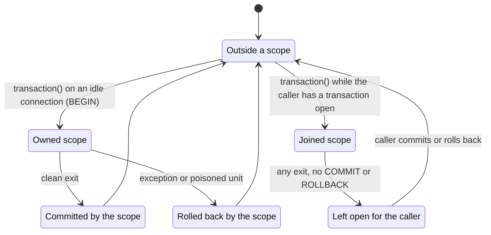

# Transactions

`IbisBackend.transaction()` groups package operations into one unit of work on the backend's native driver connection. On SQLite, DuckDB and PostgreSQL the scope first checks whether a transaction is already open: on an idle connection it begins one, commits it on a clean exit and rolls it back on failure; when the caller already has a transaction open, it joins that transaction and leaves the commit or rollback to the caller. Two read-only predicates report what is going on: `in_transaction()` for the package scope and `native_transaction_open()` for the driver. `raw_driver_connection()` hands out the native connection for work the package does not cover, and the transaction errors in `mountainash_data.core.errors` report the cases where a scope cannot honestly commit.

The examples use the table operations from [Creating and changing tables](../08-creating-and-changing-tables/index.md) and the connection lifecycle from [Installing and connecting](../02-installing-and-connecting/index.md).

<!-- concept:132 -->
## The raw driver connection

`raw_driver_connection()` returns the native driver handle behind the Ibis backend: a `sqlite3.Connection` for SQLite, a `DuckDBPyConnection` for DuckDB, a psycopg connection for PostgreSQL. It works for connections the backend opened itself and for adopted ones (see [Adopting existing connections](../11-adopting-existing-connections/index.md)), and it raises rather than returning `None` when there is no handle.

```python
from mountainash_data import IbisBackend

with IbisBackend(dialect="sqlite", database=":memory:") as backend:
    raw = backend.raw_driver_connection()
    print(type(raw))
    raw.execute("CREATE TABLE sales (id INTEGER, region TEXT, total INTEGER)")
    print(backend.list_tables())

with IbisBackend(dialect="duckdb", database=":memory:") as backend:
    print(type(backend.raw_driver_connection()))

try:
    IbisBackend(dialect="sqlite", database=":memory:").raw_driver_connection()
except RuntimeError as exc:
    print(exc)
```

```text
<class 'sqlite3.Connection'>
['sales']
<class 'duckdb.duckdb.DuckDBPyConnection'>
IbisBackend is not connected. Call connect() first.
```

The handle is an escape hatch for DDL, driver-specific idioms and the caller's own transaction control. Its kind varies by dialect: most are DB-API connections, but BigQuery exposes a client object and PySpark a Spark session, so check the dialect before assuming DB-API methods (`src/mountainash_data/core/protocol.py`, `src/mountainash_data/backends/ibis/dialects/_registry.py`). Statements run directly on this handle are outside the package's protection inside a scope; [Transaction errors](#transaction-errors) shows what happens when such a statement ends the transaction.

<!-- concept:125 -->
## Transaction scopes

`backend.transaction()` is a context manager. Package operations inside it (`insert`, `upsert`, `truncate`, `create_table`, `add_columns`, index operations, reads and inspection) run in one unit of work. When the scope owns that unit, a clean exit commits it and an exception rolls it back before propagating.

```python
import polars as pl
from mountainash_data import IbisBackend

with IbisBackend(dialect="sqlite", database=":memory:") as backend:
    raw = backend.raw_driver_connection()
    raw.execute("CREATE TABLE sales (id INTEGER PRIMARY KEY, region TEXT, total INTEGER)")
    raw.execute("INSERT INTO sales VALUES (1, 'north', 120)")
    raw.commit()

    with backend.transaction():
        backend.insert("sales", pl.DataFrame({"id": [2], "region": ["south"], "total": [95]}))
        backend.upsert(
            "sales",
            pl.DataFrame({"id": [1], "region": ["north"], "total": [130]}),
            conflict_columns=["id"],
        )

    try:
        with backend.transaction():
            backend.truncate("sales")
            raise ValueError("abandon the batch")
    except ValueError as exc:
        print(f"rolled back: {exc}")

    print(backend.run_expr(backend.table("sales").order_by("id")).to_dict("records"))
```

```text
rolled back: abandon the batch
[{'id': 1, 'region': 'north', 'total': 130}, {'id': 2, 'region': 'south', 'total': 95}]
```

The insert and upsert committed together. The truncate was rolled back, and the original `ValueError` reached the caller unchanged. Several Ibis operations commit internally (SQLite's overwrite insert is one); inside a scope the package stops those internal commits so they cannot end the unit early. [Protected package calls](../16-transaction-and-adoption-internals/index.md) explains how.

`transaction()` takes one keyword, `required` (default `True`). The `supports_transactions` property says whether the dialect has a transaction concept at all. What a scope does depends on the dialect:

| Dialects | Behaviour of `transaction()` |
|---|---|
| `sqlite`, `duckdb`, `postgres` | Checks native state on entry, then owns or joins. Package calls are protected. Exit checks that the transaction can still commit. |
| `motherduck`, `mysql`, `mssql`, `snowflake`, `redshift`, `materialize`, `trino`, `singlestoredb`, `risingwave` | The outermost scope issues the dialect's begin statement, then `COMMIT` or `ROLLBACK`. There is no native-state probe, so a caller's open transaction is not detected, and package calls are not protected. |
| `oracle`, `exasol` | As the previous row, but no begin statement is sent; the driver starts the transaction implicitly. |
| `bigquery`, `clickhouse`, `databricks`, `impala`, `druid`, `pyspark` | No transaction concept: raises `TransactionUnsupportedError`, or with `required=False` warns once and runs the body without a transaction. |

These come from each dialect's `transaction_support`, `begin_statement` and probe fields in `src/mountainash_data/backends/ibis/dialects/_registry.py`, together with the three ownership dialects named in `src/mountainash_data/backends/ibis/_transaction.py`. Trino, SingleStoreDB and RisingWave are registered with limited transaction support; for Trino it also depends on the configured connector. [Supported databases and limits](../13-supported-databases-and-limits/index.md) has the full matrix. The local tests exercise SQLite and DuckDB (`tests/test_unit/backends/ibis/test_transaction_scope.py`), and the live-database tier runs the same cases against PostgreSQL (`tests/test_live_backends/test_transaction_live.py`).



## Checking scope and native state

The two predicates answer different questions, and they can disagree.

<!-- concept:128 -->
`in_transaction()` is `True` while a `transaction()` scope is registered on this backend's native connection, at any nesting depth, whether that scope owns the unit or joined the caller's. It does not mean the package will commit. It never raises: it returns `False` on dialects with no transaction concept, on a backend that was never connected or has been closed, and when the native handle has gone away. A poisoned unit (see [Nested scopes are flat](#nested-scopes-are-flat)) is still reported as active until the scope unwinds.

<!-- concept:129 -->
`native_transaction_open()` asks the driver. It returns `True` or `False` on the ownership dialects, `False` on dialects with no transaction concept and on an unconnected or closed backend, and `None` when the dialect has no native probe (every transactional dialect other than SQLite, DuckDB and PostgreSQL). It never connects, begins a transaction or changes session settings, but probe errors propagate. On DuckDB the probe runs two short queries on the handle, which replaces any result you had not yet fetched from it.

```python
from mountainash_data import IbisBackend

backend = IbisBackend(dialect="duckdb", database=":memory:")
print(backend.in_transaction(), backend.native_transaction_open())  # not connected

backend.connect()
raw = backend.raw_driver_connection()
print(backend.in_transaction(), backend.native_transaction_open())  # idle

with backend.transaction():
    print(backend.in_transaction(), backend.native_transaction_open())  # owned scope

raw.execute("BEGIN")  # the caller's own transaction
print(backend.in_transaction(), backend.native_transaction_open())
raw.execute("ROLLBACK")
backend.close()
```

```text
False False
False False
True True
False True
```

The last line is the case that matters: the caller has a transaction open, so the driver reports one, but no package scope is registered. Use `in_transaction()` to ask "is my code running inside a package unit of work?" and `native_transaction_open()` to ask "will my statements land in an open transaction?".

<!-- concept:126 -->
## Owned and joined transactions

On SQLite, DuckDB and PostgreSQL the outermost scope decides who completes the transaction. If the native connection is idle, the scope begins a transaction and owns it. If the caller already began one, the scope joins it: no `BEGIN` on entry, and no `COMMIT` or `ROLLBACK` on exit, whether the body succeeded or raised. This lets library code wrap its work in `transaction()` and still compose with a caller who manages the transaction directly or through an adopted connection.

```python
import polars as pl
from mountainash_data import IbisBackend

with IbisBackend(dialect="duckdb", database=":memory:") as backend:
    raw = backend.raw_driver_connection()
    raw.execute("CREATE TABLE sales (id INTEGER PRIMARY KEY, region TEXT, total INTEGER)")
    raw.execute("INSERT INTO sales VALUES (1, 'north', 120)")

    raw.execute("BEGIN")  # the caller opens and owns this transaction
    raw.execute("UPDATE sales SET total = 125 WHERE id = 1")
    with backend.transaction():  # joins: no BEGIN, no COMMIT
        backend.insert("sales", pl.DataFrame({"id": [2], "region": ["south"], "total": [95]}))
    print(f"scope exited, native open: {backend.native_transaction_open()}")

    raw.execute("ROLLBACK")  # the caller decides
    print(raw.execute("SELECT * FROM sales ORDER BY id").fetchall())
```

```text
scope exited, native open: True
[(1, 'north', 120)]
```

The caller's rollback undid both its own update and the package's insert. With `COMMIT` instead, both would persist.

The package never changes the driver's autocommit setting. On PostgreSQL that has a visible consequence: with autocommit off, psycopg opens a transaction implicitly before the first statement, including a read. A package read outside a scope can therefore leave the connection inside a transaction, and a later `transaction()` sees it as the caller's and joins it rather than owning it, so nothing is committed until the caller commits. Commit or roll back after such reads, or run the connection with autocommit on, when you want later scopes to own their work. The probe reads psycopg's transaction status (idle, in a transaction, or in an aborted transaction), and an owned scope on a connection with autocommit off starts the implicit transaction instead of sending a second `BEGIN` (`src/mountainash_data/backends/ibis/dialects/_registry.py`, the PostgreSQL probe and begin hook; the read helper in `tests/helpers/transaction_cases.py` ends exactly this implicit transaction). The live tests run every case with autocommit both on and off and assert that `transaction()` left the setting unchanged (`tests/test_live_backends/test_transaction_live.py`).

On the other transactional dialects there is no probe, so the outermost scope always begins and completes its own transaction; do not open one yourself on the raw handle before calling `transaction()` there.

<!-- concept:127 -->
## Nested scopes are flat

A `transaction()` inside another scope on the same native connection joins the outer unit. There are no savepoints: the inner scope issues no `BEGIN` and no `COMMIT`, and the outermost scope completes everything. Functions can open their own scope and still be called from inside a caller's.

An exception that escapes an inner scope poisons the whole unit, even if the caller catches it. The unit can no longer commit: further package calls into it are rejected, and at the outermost exit an owned unit is rolled back and `TransactionPoisonedError` is raised. A failed package operation (an insert that violates a key, for example) poisons the unit in the same way.

```python
import polars as pl
from mountainash_data import IbisBackend
from mountainash_data.core.errors import TransactionPoisonedError


def load_region(backend, rows):
    with backend.transaction():  # joins when the caller already has a scope open
        backend.insert("sales", pl.DataFrame(rows))


with IbisBackend(dialect="sqlite", database=":memory:") as backend:
    raw = backend.raw_driver_connection()
    raw.execute("CREATE TABLE sales (id INTEGER PRIMARY KEY, region TEXT, total INTEGER)")
    raw.commit()

    with backend.transaction():
        load_region(backend, {"id": [1], "region": ["north"], "total": [120]})
        load_region(backend, {"id": [2], "region": ["south"], "total": [95]})
    print(raw.execute("SELECT count(*) FROM sales").fetchone())

    try:
        with backend.transaction():
            load_region(backend, {"id": [3], "region": ["west"], "total": [40]})
            try:
                with backend.transaction():
                    raise ValueError("bad inner batch")
            except ValueError:
                pass  # swallowed, but the unit of work is already poisoned
    except TransactionPoisonedError as exc:
        print(f"{type(exc).__name__}: {exc}")
    print(raw.execute("SELECT count(*) FROM sales").fetchone())
```

```text
(2,)
TransactionPoisonedError: unit of work was poisoned by a caught failure; rolled back
(2,)
```

Scopes are tracked per native connection, not per `IbisBackend` object. Two backends that wrap the same driver connection, such as one built with `IbisBackend.from_ibis_connection(backend.ibis_connection(), ...)`, share one unit of work: a scope opened through either is visible to `in_transaction()` on both, and a scope opened through the second joins the first. [The per-raw-handle scope registry](../16-transaction-and-adoption-internals/index.md) covers the mechanism.

<!-- concept:133 -->
## Transaction errors

The transaction errors live in `mountainash_data.core.errors` and share the base class `TransactionError`, a `RuntimeError` subclass.

| Error | Raised when | Effect on data |
|---|---|---|
| `TransactionUnsupportedError` | `transaction()` on a dialect with no transaction concept, with `required=True`. | Nothing runs. |
| `TransactionPoisonedError` | A failure was caught inside the unit: an exception from a nested scope, or a failed package call. Also raised by any later package call into the poisoned unit, before it queries. | An owned unit is rolled back. A joined unit is left for the caller to complete. |
| `TransactionIntegrityError` | On entry, the native state cannot be observed or is unknown. On exit, the native transaction already ended, is aborted, or its state is unknown. | The scope commits nothing. An owned transaction that is still open is rolled back. Work committed earlier through the raw handle stays committed. |

A scope that cannot read native state on entry refuses to start or join, because it cannot tell whether it would own the transaction. On PostgreSQL that covers a connection in the middle of a statement or in an unknown status.

The most common integrity error comes from ending the transaction behind the scope's back, through the raw handle or a direct Ibis call:

```python
from mountainash_data import IbisBackend
from mountainash_data.core.errors import TransactionIntegrityError

with IbisBackend(dialect="sqlite", database=":memory:") as backend:
    raw = backend.raw_driver_connection()
    raw.execute("CREATE TABLE sales (id INTEGER PRIMARY KEY, total INTEGER)")
    raw.execute("INSERT INTO sales VALUES (1, 120)")
    raw.commit()

    try:
        with backend.transaction():
            raw.execute("UPDATE sales SET total = 0 WHERE id = 1")
            raw.commit()  # ends the scope's transaction behind its back
    except TransactionIntegrityError as exc:
        print(f"{type(exc).__name__}: {exc}")
    print(raw.execute("SELECT * FROM sales").fetchall())
```

```text
TransactionIntegrityError: native transaction ended before scope exit (for example a COMMIT or ROLLBACK through a raw escape hatch); nothing was committed here
[(1, 0)]
```

The error reports the problem; it cannot undo the raw commit, so the update persisted. On PostgreSQL, a raw statement that fails inside a scope leaves the transaction aborted without poisoning the scope; on exit the scope sees the transaction is not eligible to commit, rolls back an owned transaction and raises `TransactionIntegrityError`. A joined scope on a caller's aborted transaction raises the same error and leaves the rollback to the caller (`tests/test_live_backends/test_transaction_live.py`).

A failed package call poisons the unit, and the next package call is refused before it touches the database:

```python
import polars as pl
from mountainash_data import IbisBackend
from mountainash_data.core.errors import TransactionPoisonedError

with IbisBackend(dialect="sqlite", database=":memory:") as backend:
    raw = backend.raw_driver_connection()
    raw.execute("CREATE TABLE sales (id INTEGER PRIMARY KEY, total INTEGER)")
    raw.commit()

    try:
        with backend.transaction():
            backend.insert("sales", pl.DataFrame({"id": [1], "total": [120]}))
            try:
                backend.insert("sales", pl.DataFrame({"id": [1], "total": [99]}))
            except Exception as exc:
                print(f"caught: {type(exc).__name__}")
            backend.list_tables()  # rejected before any query runs
    except TransactionPoisonedError as exc:
        print(f"{type(exc).__name__}: {exc}")
    print(raw.execute("SELECT count(*) FROM sales").fetchone())
```

```text
caught: IntegrityError
TransactionPoisonedError: transaction is poisoned by a prior failure in this unit of work
(0,)
```

Arguments rejected before any database work, such as an invalid index name or a malformed table name (a `ValueError`), do not poison the unit; the scope can still commit (`tests/helpers/transaction_cases.py`, the local-rejection case). Inspection behaves differently inside a scope: outside one, `list_tables()`, `list_namespaces()` and `list_catalogs()` print the error and return an empty or fallback result, while inside a scope a failed metadata query raises, because an empty answer would hide a broken unit of work.

On a dialect with no transaction concept:

```python
import warnings
from mountainash_data import IbisBackend
from mountainash_data.core.errors import TransactionUnsupportedError

backend = IbisBackend(dialect="clickhouse", host="localhost")
print(backend.supports_transactions)
try:
    with backend.transaction():
        pass
except TransactionUnsupportedError as exc:
    print(f"{type(exc).__name__}: {exc}")

with warnings.catch_warnings(record=True) as caught:
    warnings.simplefilter("always")
    with backend.transaction(required=False):
        pass
print(caught[0].message)
```

```text
False
TransactionUnsupportedError: 'clickhouse' has no transaction concept; call transaction(required=False) to run as a best-effort no-op.
'clickhouse' has no transaction support; transaction() is a no-op.
```

The backend in this example is never connected; the check happens before any connection is needed.

Three more failure cases need no error class of their own. Closing the backend, or its `get_connection()` wrapper, inside an open scope raises `RuntimeError` and leaves the connection open:

```python
from mountainash_data import IbisBackend

with IbisBackend(dialect="sqlite", database=":memory:") as backend:
    with backend.transaction():
        try:
            backend.close()
        except RuntimeError as exc:
            print(exc)
```

```text
cannot close the connection inside an open transaction() scope
```

If `COMMIT` itself fails on an ownership dialect, the driver's error propagates and the commit is not retried, because its outcome is unknown. When the backend opened the connection itself, it also drops that connection so it is not reused; call `connect()` again before further work. An adopted connection is left to its owner. If a rollback fails while an exception is already propagating, the original exception is raised with the rollback failure attached as its context or a note.

<!-- concept:156 -->
## The memtable rollback caveat

Ibis stages an in-memory table (`ibis.memtable(...)`, and the data frames that package writes convert into one) as a temporary table on the connection and remembers that it has done so. When a scope rolls back, the database drops the temporary table but Ibis's record of it remains, so reusing the same memtable expression afterwards fails:

```python
import ibis
from mountainash_data import IbisBackend

with IbisBackend(dialect="sqlite", database=":memory:") as backend:
    raw = backend.raw_driver_connection()
    raw.execute("CREATE TABLE sales (id INTEGER, total INTEGER)")
    raw.commit()

    batch = ibis.memtable({"id": [3], "total": [40]})
    try:
        with backend.transaction():
            backend.insert("sales", batch)
            raise ValueError("abandon")
    except ValueError:
        pass

    try:
        backend.insert("sales", batch)  # the same expression, after the rollback
    except Exception as exc:
        print(f"{type(exc).__name__}: {exc}")

    backend.insert("sales", ibis.memtable({"id": [3], "total": [40]}))  # a fresh one works
    print(raw.execute("SELECT * FROM sales").fetchall())
```

```text
OperationalError: no such table: ibis_pandas_memtable_i2ymwlwv55hkbl3epobcvvymwa
[(3, 40)]
```

The generated table name differs on every run. DuckDB fails the same way with a `CatalogException`. The package installs no workaround: build a fresh memtable, or pass the source data frame again, when retrying work after a rollback. Passing a data frame creates a new memtable on each call, which is why the rollback examples above can retry safely. The [transaction recipe](https://github.com/mountainash-io/mountainash-data/tree/develop/examples/transactions) follows the same rule. The registration that goes stale belongs to Ibis; see the [Ibis memtable documentation](https://ibis-project.org/reference/expression-tables#ibis.memtable).
