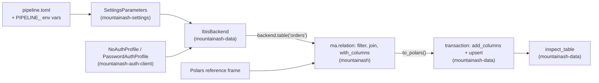

# An end-to-end pipeline

A typical mountainash pipeline reads its connection from a configuration file, opens the database through `IbisBackend`, combines a database table with local reference data using `mountainash` expressions, and writes the results back to the database with upsert inside a transaction. Four packages share the work, and each step belongs to exactly one of them. The pipeline on this page is written once and runs unchanged on DuckDB and on SQLite: the engine is chosen by configuration, not by code.

The examples run against DuckDB and SQLite files in the working directory. They need `mountainash-data` with its `duckdb`, `sqlite` and `polars` extras, together with [`mountainash-settings`](https://github.com/mountainash-io/mountainash-settings), [`mountainash-auth-client`](https://github.com/mountainash-io/mountainash-auth-client) and [`mountainash`](https://github.com/mountainash-io/mountainash).

<!-- concept:167 -->
## Writing expression results back

`mountainash` evaluates relations; it does not write to databases. `mountainash-data` writes to databases; it never imports `mountainash`. The two meet at plain data. A relation built over `backend.table(...)` is evaluated with a terminal such as `to_polars()`, and the resulting frame goes to the backend's physical write methods, which accept frames, lists of dicts and Ibis tables. Inside one `backend.transaction()` the write is a single unit: widen the target with `add_columns` when the results carry a column the table lacks, then `upsert` the rows on their key.

```python
import mountainash as ma
from mountainash_data import IbisBackend

backend = IbisBackend(dialect="duckdb", database=":memory:")
backend.connect()
backend.create_table("scores", [{"id": 1, "score": 40}, {"id": 2, "score": 75}])
backend.create_table("grades", [{"id": 1, "score": 35}])
backend.create_unique_index("grades", "id")

results = (
    ma.relation(backend.table("scores"))
    .with_columns(ma.col("score").ge(50).alias("passed"))
    .to_polars()
)

with backend.transaction():
    backend.add_columns("grades", results)
    backend.upsert("grades", results, conflict_columns="id")

print(backend.table("grades").order_by("id").to_pyarrow().to_pylist())
# → [{'id': 1, 'score': 40, 'passed': False}, {'id': 2, 'score': 75, 'passed': True}]
```

`add_columns` read only the frame's schema and added `passed`, the one column `grades` did not have. `upsert` then updated row 1 and inserted row 2. The unique index on `id` is required: on DuckDB and SQLite the engine only recognises a conflict against a unique index or primary key on the conflict columns, as [Creating and changing tables](../08-creating-and-changing-tables/index.md#upsert) explains.

Because the schema change and the row change share a scope, a failure anywhere in the scope undoes both. On SQLite, DuckDB and PostgreSQL the scope owns the transaction when the connection is idle, so an exception rolls back the `ALTER TABLE` along with the upsert:

```python
try:
    with backend.transaction():
        backend.add_columns("grades", {"reviewer": "string"})
        backend.upsert("grades", [{"id": 1, "score": 0}], conflict_columns="id")
        raise RuntimeError("reconciliation check failed")
except RuntimeError as exc:
    print("rolled back:", exc)

print(backend.table("grades").columns)
print(backend.table("grades").order_by("id").to_pyarrow().to_pylist()[0])
backend.close()
```

```text
rolled back: reconciliation check failed
('id', 'score', 'passed')
{'id': 1, 'score': 40, 'passed': False}
```

The `reviewer` column was not left behind and row 1 kept its score. The same two blocks give the same output with `dialect="sqlite"`. On the other transactional dialects the scope issues the dialect's begin, commit and rollback statements but cannot detect a transaction the caller already opened; the per-dialect behaviour is in [Transactions](../10-transactions/index.md#transaction-scopes). How upsert matches keys on each engine, and what `add_columns` does with existing columns, is in [Creating and changing tables](../08-creating-and-changing-tables/index.md#adding-columns).

Writing the evaluated frame, rather than a relation, keeps the boundary in place: the write methods see ordinary rows and an Ibis-inferred schema, whichever backends the relation combined to produce them.

<!-- concept:169 -->
## The pipeline end to end

The pipeline below enriches completed orders with region names held outside the database, flags large orders, and maintains an `order_facts` table keyed by order id. Each step is owned by one package:

| Step | Owner | What it does here |
|---|---|---|
| Configuration file and environment overrides | `mountainash-settings` | Reads the engine, database path and pipeline options into typed settings and a `SettingsParameters` recipe |
| Credentials | `mountainash-auth-client` | Supplies the auth profile at connect time, separate from the configuration |
| Connection, table access, physical writes, inspection | `mountainash-data` | Turns the recipe into a live `IbisBackend`; hands out the native table; runs `add_columns` and `upsert` in a transaction; reports `TableInfo` |
| Filter, join with local data, derived column | `mountainash` | Evaluates one relation over the database table and a Polars frame |



The blocks that follow run in order as one script; each continues from the one before it.

### The configuration file

One TOML file holds both the connection and the pipeline's own options. `BACKEND` names the backend profile, `DATABASE` is that profile's field, and the remaining keys belong to the application:

```toml
# pipeline.toml
# Which engine and file hold the warehouse
BACKEND = "duckdb"
DATABASE = "warehouse.duckdb"

# What the pipeline reads and writes
SOURCE_TABLE = "orders"
TARGET_TABLE = "order_facts"
LARGE_ORDER_THRESHOLD = 100
```

`mountainash-settings` reads YAML, JSON and dotenv files the same way; see [Configuring connections with mountainash-settings](../04-configuring-connections-with-mountainash-settings/index.md).

### Settings and connection parameters

Two settings classes read the same file. `PipelineSettings` is the application's own `MountainAshBaseSettings` subclass. The connection recipe is a `SettingsParameters` whose settings class is looked up by name with `get_settings_class`, so the profile class follows the `BACKEND` value in the file. Each class takes the fields it declares and ignores the rest, and both honour `PIPELINE_`-prefixed environment variables.

```python
from mountainash_settings import MountainAshBaseSettings, SettingsParameters
from mountainash_data.core.settings import get_settings_class


class PipelineSettings(MountainAshBaseSettings):
    BACKEND: str
    SOURCE_TABLE: str
    TARGET_TABLE: str
    LARGE_ORDER_THRESHOLD: int


def load_settings(config_file):
    app = PipelineSettings(config_files=[config_file], env_prefix="PIPELINE_")
    params = SettingsParameters.create(
        settings_class=get_settings_class(app.BACKEND),
        config_files=[config_file],
        env_prefix="PIPELINE_",
    )
    return app, params


app, params = load_settings("pipeline.toml")
print(app.BACKEND, app.SOURCE_TABLE, app.TARGET_TABLE, app.LARGE_ORDER_THRESHOLD)
print(params.settings_class.__name__)
```

```text
duckdb orders order_facts 100
DuckDBBackendProfile
```

`params` is a recipe, not a connection: it names the profile class and its sources, and the values are resolved when `IbisBackend` materialises it. That is what lets an orchestrator ship the recipe to a worker and connect there. Recipes, secret references and worker boundaries are covered in [chapter 4](../04-configuring-connections-with-mountainash-settings/index.md); the profile classes are in [Connection profiles and authentication](../03-connection-profiles-and-authentication/index.md#backendprofile-and-settingsparameters).

### The source table

In production the `orders` table is written by another system. Here a `seed` function creates it, along with yesterday's `order_facts`, which has one row and no `region_name` or `large_order` columns yet. The unique index on `order_facts.id` is the upsert key.

```python
from mountainash_data import IbisBackend
from mountainash_data.core.settings import NoAuthProfile


def seed(params):
    with IbisBackend(params) as backend:
        backend.connect(auth_profile=NoAuthProfile())
        backend.create_table(
            "orders",
            [
                {"id": 1, "region_code": "N", "status": "complete", "amount": 120.0},
                {"id": 2, "region_code": "S", "status": "complete", "amount": 45.5},
                {"id": 3, "region_code": "N", "status": "cancelled", "amount": 300.0},
                {"id": 4, "region_code": "W", "status": "complete", "amount": 180.0},
                {"id": 5, "region_code": "S", "status": "complete", "amount": 99.0},
            ],
            overwrite=True,
        )
        backend.create_table(
            "order_facts", [{"id": 1, "region_code": "N", "amount": 110.0}], overwrite=True
        )
        backend.create_unique_index("order_facts", "id")


seed(params)
```

### Connecting

`IbisBackend(params)` validates the profile and picks the dialect from it. Credentials arrive separately, at `connect()`. A DuckDB or SQLite file needs none, so the pipeline passes `NoAuthProfile`; a PostgreSQL profile would take a `PasswordAuthProfile` from `mountainash-auth-client` at the same call, and the configuration file would never hold the password. See [Connection profiles and authentication](../03-connection-profiles-and-authentication/index.md#connect-time-composition).

```python
backend = IbisBackend(params)
backend.connect(auth_profile=NoAuthProfile())
print(backend.dialect, backend.list_tables())
# → duckdb ['order_facts', 'orders']
```

### Joining database and local data

`backend.table(...)` returns the native Ibis table, and `ma.relation(...)` turns it into a `mountainash` relation. From there the pipeline is written in `mountainash` expressions only: filter completed orders, join the region names from a local Polars frame, and derive `large_order` from the threshold in the configuration file.

```python
import polars as pl
import mountainash as ma

regions = pl.DataFrame(
    {"region_code": ["N", "S", "W"], "region_name": ["North", "South", "West"]}
)

orders = ma.relation(backend.table(app.SOURCE_TABLE))
facts = (
    orders
    .filter(ma.col("status") == "complete")
    .join(ma.relation(regions), on="region_code")
    .with_columns(
        ma.col("amount").gt(app.LARGE_ORDER_THRESHOLD).alias("large_order")
    )
    .select("id", "region_code", "region_name", "amount", "large_order")
    .sort("id")
)
results = facts.to_polars()
print(results)
```

```text
shape: (4, 5)
┌─────┬─────────────┬─────────────┬────────┬─────────────┐
│ id  ┆ region_code ┆ region_name ┆ amount ┆ large_order │
│ --- ┆ ---         ┆ ---         ┆ ---    ┆ ---         │
│ i64 ┆ str         ┆ str         ┆ f64    ┆ bool        │
╞═════╪═════════════╪═════════════╪════════╪═════════════╡
│ 1   ┆ N           ┆ North       ┆ 120.0  ┆ true        │
│ 2   ┆ S           ┆ South       ┆ 45.5   ┆ false       │
│ 4   ┆ W           ┆ West        ┆ 180.0  ┆ true        │
│ 5   ┆ S           ┆ South       ┆ 99.0   ┆ false       │
└─────┴─────────────┴─────────────┴────────┴─────────────┘
```

The cancelled order 3 was filtered out. The reference frame could equally be a list of dicts passed to `ma.relation`. The join across a database table and local data is planned by `mountainash`, not by this package; [Running mountainash expressions against databases](../07-running-mountainash-expressions-against-databases/index.md) describes the relation handoff and how the same expressions run on local frames.

### Writing the results back

The results carry two columns that `order_facts` does not have. One transaction widens the table and upserts the rows (see [Writing expression results back](#writing-expression-results-back)):

```python
print(backend.table(app.TARGET_TABLE).columns)
# → ('id', 'region_code', 'amount')

with backend.transaction():
    backend.add_columns(app.TARGET_TABLE, results)
    backend.upsert(app.TARGET_TABLE, results, conflict_columns="id")

print(backend.in_transaction(), backend.native_transaction_open())
# → False False
```

After the scope exits, neither the package scope nor the driver has a transaction open: the scope owned the transaction and committed it. Running the pipeline again is safe. `add_columns` finds nothing to add and `upsert` rewrites the same keys, so the table converges on the same contents.

### Inspecting the result

`inspect_table` returns the physical metadata model (`TableInfo` with `ColumnInfo` entries), the same on every engine; see [Inspecting databases](../05-inspecting-databases/index.md#cataloginfo-namespaceinfo-tableinfo-columninfo-indexinfo).

```python
info = backend.inspect_table(app.TARGET_TABLE)
print(info.qualified_name)
for column in info.columns:
    print(f"  {column.name:<12} {column.type_name}")

for row in backend.table(app.TARGET_TABLE).order_by("id").to_pyarrow().to_pylist():
    print(row)
backend.close()
```

```text
order_facts
  id           int64
  region_code  string
  amount       float64
  region_name  string
  large_order  boolean
{'id': 1, 'region_code': 'N', 'amount': 120.0, 'region_name': 'North', 'large_order': True}
{'id': 2, 'region_code': 'S', 'amount': 45.5, 'region_name': 'South', 'large_order': False}
{'id': 4, 'region_code': 'W', 'amount': 180.0, 'region_name': 'West', 'large_order': True}
{'id': 5, 'region_code': 'S', 'amount': 99.0, 'region_name': 'South', 'large_order': False}
```

Row 1 was updated from 110.0 to 120.0 and gained the new columns; rows 2, 4 and 5 were inserted.

### Pointing the pipeline at another engine

Collected into one function, the pipeline takes a configuration file and the reference data, and contains no engine-specific code:

```python
def run_pipeline(config_file, regions):
    app, params = load_settings(config_file)
    with IbisBackend(params) as backend:
        backend.connect(auth_profile=NoAuthProfile())
        results = (
            ma.relation(backend.table(app.SOURCE_TABLE))
            .filter(ma.col("status") == "complete")
            .join(ma.relation(regions), on="region_code")
            .with_columns(
                ma.col("amount").gt(app.LARGE_ORDER_THRESHOLD).alias("large_order")
            )
            .select("id", "region_code", "region_name", "amount", "large_order")
            .sort("id")
            .to_polars()
        )
        with backend.transaction():
            backend.add_columns(app.TARGET_TABLE, results)
            backend.upsert(app.TARGET_TABLE, results, conflict_columns="id")
        rows = backend.table(app.TARGET_TABLE).order_by("id").to_pyarrow().to_pylist()
        return backend.dialect, rows
```

A second configuration file differs from the first in two lines:

```toml
# pipeline-sqlite.toml
BACKEND = "sqlite"
DATABASE = "warehouse.sqlite"

SOURCE_TABLE = "orders"
TARGET_TABLE = "order_facts"
LARGE_ORDER_THRESHOLD = 100
```

Running both, starting from freshly seeded files, gives the same rows on each engine:

```python
for config_file in ("pipeline.toml", "pipeline-sqlite.toml"):
    seed(load_settings(config_file)[1])
    dialect, rows = run_pipeline(config_file, regions)
    print(dialect, rows[0])
    print(dialect, rows[-1])
```

```text
duckdb {'id': 1, 'region_code': 'N', 'amount': 120.0, 'region_name': 'North', 'large_order': True}
duckdb {'id': 5, 'region_code': 'S', 'amount': 99.0, 'region_name': 'South', 'large_order': False}
sqlite {'id': 1, 'region_code': 'N', 'amount': 120.0, 'region_name': 'North', 'large_order': True}
sqlite {'id': 5, 'region_code': 'S', 'amount': 99.0, 'region_name': 'South', 'large_order': False}
```

The engine can also be switched without a second file. The environment overrides the file for every `PIPELINE_`-prefixed field, in both settings classes:

```python
import os

os.environ["PIPELINE_BACKEND"] = "sqlite"
os.environ["PIPELINE_DATABASE"] = "warehouse.sqlite"
app, params = load_settings("pipeline.toml")
print(params.settings_class.__name__)

with IbisBackend(params) as backend:
    backend.connect(auth_profile=NoAuthProfile())
    print(backend.dialect, backend.list_tables())
```

```text
SQLiteBackendProfile
sqlite ['order_facts', 'orders']
```

What changed between engines is the profile class, the driver, the upsert SQL and the `ALTER TABLE` statement. The profile class and driver come from configuration through `mountainash-settings` and `IbisBackend`. This package renders the SQL for the connected dialect: `ON CONFLICT` on DuckDB and SQLite, `MERGE` or `ON DUPLICATE KEY` on engines that use those forms. The relation is compiled by `mountainash` for whichever backend holds the table. For a server database the same function needs a server profile in the file and a credential at `connect()`; which operations each dialect supports, and how transaction scopes behave there, is listed in [Supported databases and limits](../13-supported-databases-and-limits/index.md).
