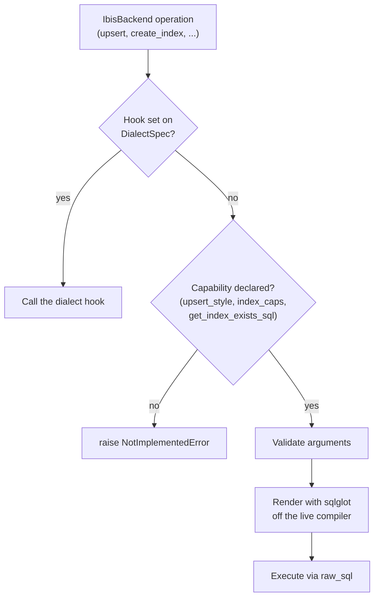

# How one backend serves 20 dialects

`IbisBackend` is a single class that connects to, inspects and writes to 20 different database engines. It contains no per-database subclasses. Everything that differs between engines (how to open a connection, which upsert statement to emit, whether partial indexes exist, how to begin a transaction) is declared as data in one frozen record per dialect, and `IbisBackend` reads that record whenever it has to make an engine-specific decision. Operations that need hand-written SQL are rendered generically through [sqlglot](https://sqlglot.com/) off the live connection's own compiler, so one implementation covers every dialect that declares the capability.

## DialectSpec and the DIALECTS registry

<!-- concept:57 -->
A `DialectSpec` is a frozen dataclass describing one dialect. It is defined in `src/mountainash_data/backends/ibis/dialects/_registry.py`, a private module: the spec is the package's internal contract between `IbisBackend` and the per-dialect knowledge, and extension authors interact with it as described in [Extending mountainash-data](../17-extending-mountainash-data/index.md). Every field has a default except the three identity fields, so a minimal dialect needs only a name, a connection scheme and a builder, and every capability it leaves unset reads as "not supported".

The fields fall into five groups.

| Group | Fields | What `IbisBackend` uses them for |
|---|---|---|
| Identity and connection | `ibis_backend_name`, `connection_string_scheme`, `connection_mode`, `connection_builder`, `ibis_connection_adapter`, `raw_handle_attr`, `extras` | Importing the right Ibis backend module, mapping URL schemes to dialects, building the connection, patching it, and finding the native driver handle |
| Write capabilities | `upsert_style`, `index_caps` | Choosing the generic SQL family for upsert, and whether and how index DDL is rendered |
| Operation hooks | `upsert_hook`, `add_columns_hook`, `rename_table_hook`, `truncate_table_hook`, `create_index_hook`, `drop_index_hook`, `list_indexes_hook`, `get_index_exists_sql`, `get_list_indexes_sql` | Per-dialect overrides and the catalog SQL generators that the generic index path needs |
| Transactions | `transaction_support`, `begin_statement`, `in_transaction_probe`, `precommit_probe`, `begin_hook`, `raw_execute_hook` | Opening, observing and completing explicit transaction scopes |
| Adoption | `raw_adoption_verified`, `adoption_mutations` | Gating `from_raw_connection()` and restoring session options Ibis changes on adoption |

The record is plain data, so its contents can be read at runtime. This is the SQLite entry:

```python
from mountainash_data.backends.ibis.dialects._registry import DIALECTS

spec = DIALECTS["sqlite"]
print(spec.ibis_backend_name, spec.connection_string_scheme)
print(spec.upsert_style, spec.transaction_support, spec.begin_statement)
print(spec.index_caps)
print(spec.upsert_hook, spec.truncate_table_hook is not None)
```

```text
sqlite sqlite://
UpsertStyle.ON_CONFLICT TransactionSupport.FULL BEGIN
IndexCapability(drop_scope=<DropScope.SCHEMA_GLOBAL: 'schema_global'>, partial=True, native_if_not_exists=True, native_if_exists=True, index_types=frozenset())
None True
```

Read as a sentence, this says: SQLite connects through Ibis's `sqlite` backend, upserts with `INSERT ... ON CONFLICT`, supports full transactions started with `BEGIN`, supports partial indexes with native `IF [NOT] EXISTS` guards and no `USING` clause, has no upsert override, and overrides truncation.

Two fields are populated but never read by any source module: `connection_mode` (one of `"connection_string"`, `"kwargs"` or `"hybrid"`, a holdover from the per-dialect classes the registry replaced) and `extras`. The profile record for `backends.ibis.dialects` lists both as dead fields. The connection mode that actually applies is whatever the dialect's `connection_builder` does.

<!-- concept:58 -->
`DIALECTS` is a module-level `dict[str, DialectSpec]` with 20 entries: `sqlite`, `duckdb`, `motherduck`, `postgres`, `mysql`, `mssql`, `oracle`, `snowflake`, `bigquery`, `redshift`, `trino`, `clickhouse`, `databricks`, `singlestoredb`, `exasol`, `impala`, `materialize`, `risingwave`, `druid` and `pyspark`. It is the only place a dialect exists. `IbisBackend` resolves a spec in each of its three construction paths (the `dialect=` keyword, a URL, and `SettingsParameters`), keeps it as `self._spec`, and from then on every engine-specific branch is a field read on that object (`src/mountainash_data/backends/ibis/backend.py`).

An unknown key fails at construction, before any driver import:

```text
KeyError: "Unknown ibis dialect 'nosuch'. Available: ['bigquery', 'clickhouse', 'databricks', 'druid', 'duckdb', 'exasol', 'impala', 'materialize', 'motherduck', 'mssql', 'mysql', 'oracle', 'postgres', 'pyspark', 'redshift', 'risingwave', 'singlestoredb', 'snowflake', 'sqlite', 'trino']"
```

At import, `backend.py` also derives a URL-scheme lookup from the registry by splitting each `connection_string_scheme` at `://`. The first dialect to claim a scheme wins, so `postgres://` resolves to `postgres` rather than `redshift`, and `postgresql` is added as an alias. Because `databricks` declares an empty scheme, the derived map contains an empty-string key; Databricks has no URL form and is reached by keyword or settings only.

<!-- concept:59 -->
The registry key is the dialect name a caller passes as `IbisBackend(dialect=...)`, and it is deliberately distinct from two other names. `ibis_backend_name` is the Ibis module that does the work: `motherduck` runs on Ibis's `duckdb` backend and `redshift` on its `postgres` backend. The settings layer's backend names, used by `*BackendProfile` classes and the auth adapters in [From settings to driver arguments](../15-from-settings-to-driver-arguments/index.md), differ again in places (`postgresql` there, `postgres` here). URL detection lands on the registry key:

```python
from mountainash_data import IbisBackend

for url in ("postgresql://db.example/app", "postgres://db.example/app",
            "duckdb://md:analytics", "sqlite://"):
    print(f"{url:<29} -> {IbisBackend(url).dialect}")

try:
    IbisBackend("redshift://cluster.example:5439/dev")
except ValueError as exc:
    print(f"ValueError: {exc}")
```

```text
postgresql://db.example/app   -> postgres
postgres://db.example/app     -> postgres
duckdb://md:analytics         -> motherduck
sqlite://                     -> sqlite
ValueError: Cannot detect ibis dialect from URL scheme: 'redshift'
```

`duckdb://md:` is special-cased to `motherduck` before the scheme lookup. Redshift has no URL scheme of its own in the registry (its spec declares `postgres://`), so the `redshift` entry is reachable only as `dialect="redshift"`.

The settings path picks its key differently again: it reads `ibis_dialect` from the profile's `BackendSpec`. For the two rides-on backends that value is the base dialect, `"postgres"` for `RedshiftBackendProfile` and `"duckdb"` for `MotherDuckBackendProfile`, so a backend built from those settings uses the `postgres` or `duckdb` entry (builder, upsert style, index and transaction capabilities), not the `redshift` or `motherduck` one (`src/mountainash_data/backends/ibis/backend.py`, `_init_from_settings`). The consequences for MotherDuck are shown in [From settings to driver arguments](../15-from-settings-to-driver-arguments/index.md).

## Connection builders

<!-- concept:60 -->
A connection builder is the callable in `DialectSpec.connection_builder`. It takes the merged configuration as keyword arguments and returns a live Ibis backend object. `IbisBackend.connect()` imports the dialect's Ibis module first (turning a missing driver into an `ImportError` that names the extra to install), resolves configuration and auth, drops empty list and tuple values, and calls the builder. The builder's result is wrapped in an `IbisConnection`, which applies `ibis_connection_adapter` if the dialect declares one.

The 20 builders in `_registry.py` fall into three shapes:

| Shape | Dialects | How the builder calls Ibis |
|---|---|---|
| URL plus credential kwargs | `postgres`, `redshift`, `mysql`, `mssql`, `oracle`, `snowflake`, `trino`, `duckdb`, `motherduck` | Builds a credential-free URL (`postgres://host:port/db`) and passes `user`/`password` and other options as keyword arguments to `ibis.connect` |
| Backend `connect()` with kwargs | `clickhouse`, `databricks`, `singlestoredb`, `exasol`, `impala`, `materialize`, `risingwave`, `druid` | Calls `ibis.<backend>.connect(**kwargs)` directly with defaults filled in |
| Bespoke | `sqlite`, `bigquery`, `pyspark` | `ibis.sqlite.connect(database)`; BigQuery builds service-account credentials or falls back to application default credentials; PySpark builds or reuses a `SparkSession` and applies static Spark options before session creation |

The URL builders never put credentials in the URL. Ibis percent-decodes a URL password but not the user name, so a user name containing `@`, `:` or `/` would be corrupted in URL form; passing both as keyword arguments, which `ibis.connect` merges over the parsed URL, avoids that. Every `ibis.connect` call from a builder also goes through the package's credential-redaction wrapper, described in [Credential redaction](../15-from-settings-to-driver-arguments/index.md). Most builders pass unrecognised keys through to Ibis untouched, so driver options the builder does not know about still reach the driver; the SQLite and BigQuery builders are the exceptions and read only their own keys.

<!-- concept:62 -->
Per-dialect configuration is the set of defaults and adaptations a builder applies before Ibis sees the call. Most of it is ordinary default filling (`host="localhost"`, the engine's usual port: 5432, 3306, 1433, 1521, 8080, 9000, 21050, 6875, 8563), but several dialects carry real behaviour here:

| Dialect | Builder behaviour |
|---|---|
| `duckdb` | No `database` means in-memory with `read_only=False`; a path is prefixed with `duckdb://` unless it already has it |
| `motherduck` | Builds `duckdb://md:<database>?motherduck_token=<token>` with the token percent-encoded, and registers the token as a secret for redaction |
| `snowflake`, `trino` | Accept either a full `connection_string` plus extra kwargs, or components (`account`/`database`/`schema` for Snowflake, `catalog`/`schema` for Trino) |
| `oracle` | Wraps the result in the Oracle compatibility patch (see [Compatibility shims](#compatibility-shims)) |
| `clickhouse` | Defaults `user="default"`, `password=""`, `database="default"` |
| `singlestoredb`, `materialize` | Default `autocommit=True` |
| `pyspark` | Rejects `spark.remote` with `spark.master`, and an existing `session` combined with Spark options, with a `ValueError` |

Three spec fields complete the connection picture. `raw_handle_attr` names the attribute on the Ibis backend that holds the native driver handle (`"con"` by default, `"client"` for BigQuery, `"_session"` for PySpark); `raw_driver_connection()` and the transaction machinery read through it. `ibis_connection_adapter` is a callable applied to every Ibis connection the package wraps, including adopted ones. `adoption_mutations` lists the session options Ibis overwrites when it adopts a DuckDB handle, so they can be restored, as described in [Transaction and adoption internals](../16-transaction-and-adoption-internals/index.md).

## Capability descriptors

The write and transaction capabilities of a dialect are small enums and one dataclass. `None` on an optional capability field means "not supported", and the generic path turns that into `NotImplementedError` rather than emitting SQL the engine would reject.

<!-- concept:145 -->
`DropScope` says how an engine names an index in `DROP INDEX`. `SCHEMA_GLOBAL` engines (SQLite, DuckDB, MotherDuck, PostgreSQL, Oracle) treat index names as unique within a schema, so the statement is `DROP INDEX name`. `TABLE_SCOPED` engines (MySQL, SQL Server, SingleStoreDB) scope index names to a table and require `DROP INDEX name ON table`. The generic `drop_index` uses this both to render the statement and to validate arguments: on a table-scoped dialect a call without `table_name` raises `ValueError("drop_index requires table_name for this dialect (DROP INDEX ... ON tbl)")` before any SQL runs.

<!-- concept:118 -->
`IndexCapability` is a frozen dataclass stored in `DialectSpec.index_caps`. Its presence means the engine has conventional secondary indexes; `None` means `create_index`, `drop_index` and `list_indexes` raise `NotImplementedError`.

| Field | Meaning |
|---|---|
| `drop_scope` | A `DropScope` value, as above |
| `partial` | The engine accepts a `WHERE` filter on an index (a partial or filtered index) |
| `native_if_not_exists` | The engine has `CREATE INDEX IF NOT EXISTS`; otherwise idempotency is emulated by an existence query first |
| `native_if_exists` | The engine has `DROP INDEX IF EXISTS`; otherwise emulated the same way |
| `index_types` | The valid `USING <type>` values; an empty set means no `USING` clause is accepted |

The descriptor is enforced before any SQL is sent. DuckDB declares `partial=False` and no index types:

```python
import polars as pl
from mountainash_data import IbisBackend

with IbisBackend(dialect="duckdb") as be:
    be.create_table("orders", pl.DataFrame({"id": [1], "status": ["open"]}))
    for kwargs in ({"where": lambda t: t.status == "open"}, {"index_type": "gin"}):
        try:
            be.create_index("orders", "id", **kwargs)
        except ValueError as exc:
            print(f"ValueError: {exc}")
```

```text
ValueError: this dialect does not support partial indexes (where=)
ValueError: index_type 'gin' not supported by this dialect; valid: none
```

PostgreSQL declares `{"btree", "hash", "gist", "gin", "brin", "spgist"}`, MySQL `{"btree"}` and SingleStoreDB `{"btree", "hash"}`. Where the existence check is emulated (MySQL, SingleStoreDB, Oracle, and SQL Server for creation), the precheck and the DDL are two statements, so a concurrent writer can race between them; the engine's error is surfaced, never swallowed (`src/mountainash_data/backends/ibis/_index.py`). The user-facing behaviour is in [Indexes](../09-indexes/index.md).

<!-- concept:121 -->
`UpsertStyle` selects which SQL family the generic upsert renders. `ON_CONFLICT` emits `INSERT ... SELECT ... ON CONFLICT (...) DO UPDATE/NOTHING` and is declared by SQLite, DuckDB, MotherDuck, PostgreSQL and RisingWave. `MERGE` emits `MERGE INTO ... USING ... WHEN MATCHED ... WHEN NOT MATCHED` and is declared by SQL Server, Oracle, Snowflake, BigQuery, Redshift, Trino, Databricks and Exasol. `ON_DUPLICATE_KEY` emits MySQL's `INSERT ... ON DUPLICATE KEY UPDATE` and is declared by MySQL and SingleStoreDB; this family runs a live unique-index preflight first and rejects `update_condition`. A `None` style (ClickHouse, Impala, Materialize, Druid, PySpark) makes `upsert()` raise `NotImplementedError`. The MySQL family uses `VALUES(col)`, which MySQL 8.0.20 and later deprecate; it is tested against MariaDB only (profile record `backends.ibis.operations`).

<!-- concept:130 -->
`TransactionSupport` has three values. `NONE` dialects (BigQuery, ClickHouse, Databricks, Impala, Druid, PySpark) have no transaction concept: `transaction()` raises `TransactionUnsupportedError`, or runs as a no-op with a one-time warning when called with `required=False`, and both `in_transaction()` and `native_transaction_open()` return `False`. `FULL` and `LIMITED` dialects open a real scope. In the current source the two are handled identically; `LIMITED` (Trino, SingleStoreDB, RisingWave) records that the engine's transactional guarantees are narrower, for instance Trino's depend on the configured connector, and does not change dispatch.

The descriptor sits beside the fields that make a scope work on each engine:

| Field | Role | Set by |
|---|---|---|
| `begin_statement` | SQL that opens a unit; `None` means the driver opens one implicitly | `"BEGIN"` on most; `"BEGIN TRANSACTION"` on SQL Server; `"START TRANSACTION"` on Trino; `None` on Oracle and Exasol |
| `in_transaction_probe` | Reads whether the native driver has a transaction open | SQLite, DuckDB, PostgreSQL |
| `precommit_probe` | Whether a commit is still eligible when that differs from presence | PostgreSQL (`INERROR` is open but not committable) |
| `begin_hook` | Starts a unit in place of `begin_statement` | PostgreSQL (avoids a second `BEGIN` when autocommit is off) |

Only SQLite, DuckDB and PostgreSQL observe native state on entry and can join a caller's open transaction; the mechanism is covered in [Transaction and adoption internals](../16-transaction-and-adoption-internals/index.md) and its use in [Transactions](../10-transactions/index.md). MotherDuck declares `FULL` with no probe and is outside that set, so it uses plain `BEGIN`/`COMMIT`.

The capability columns across the whole registry can be listed directly:

```python
from mountainash_data.backends.ibis.dialects._registry import DIALECTS

for key, spec in DIALECTS.items():
    caps = spec.index_caps
    print(
        f"{key:<14}{spec.ibis_backend_name:<14}"
        f"{spec.upsert_style.value if spec.upsert_style else '-':<18}"
        f"{caps.drop_scope.value if caps else '-':<14}"
        f"{spec.transaction_support.value}"
    )
```

```text
sqlite        sqlite        on_conflict       schema_global full
duckdb        duckdb        on_conflict       schema_global full
motherduck    duckdb        on_conflict       schema_global full
postgres      postgres      on_conflict       schema_global full
mysql         mysql         on_duplicate_key  table_scoped  full
mssql         mssql         merge             table_scoped  full
oracle        oracle        merge             schema_global full
snowflake     snowflake     merge             -             full
bigquery      bigquery      merge             -             none
redshift      postgres      merge             -             full
trino         trino         merge             -             limited
clickhouse    clickhouse    -                 -             none
databricks    databricks    merge             -             none
singlestoredb singlestoredb on_duplicate_key  table_scoped  limited
exasol        exasol        merge             -             full
impala        impala        -                 -             none
materialize   materialize   -                 -             full
risingwave    risingwave    on_conflict       -             limited
druid         druid         -                 -             none
pyspark       pyspark       -                 -             none
```

A declared capability is a statement about what the package will render, not a guarantee that the engine accepts it in every deployment. [Supported databases and limits](../13-supported-databases-and-limits/index.md) gives the tested support matrix.

## Generic-default operations and sqlglot rendering

<!-- concept:124 -->
The shared rendering primitives live in `src/mountainash_data/backends/ibis/_render.py`. Their rule is to render everything off the live Ibis connection's own compiler: the dialect is `ibis_conn.compiler.dialect` (a sqlglot dialect, not Ibis's backend name), identifiers are quoted with `sqlglot.exp.to_identifier(name, quoted=True)` in that dialect, and column types come from the connection's type mapper. The result is that a column added by `add_columns` or staged for an upsert gets exactly the type spelling and quoting Ibis itself would use in `create_table`.

Two predicate compilers turn Ibis expressions into SQL fragments without string manipulation. For an upsert `update_condition` of the form `(incoming, existing) -> bool`, the compiler binds two sentinel-named Ibis tables with the target's schema, joins them on the predicate, compiles the join to a sqlglot AST, extracts the `ON` sub-tree and rewrites each column's table qualifier to the alias the statement needs (`EXCLUDED` for `ON CONFLICT`, `src`/`tgt` for `MERGE`). For a partial-index `where=`, it filters one sentinel table, extracts the `WHERE` and strips every qualifier. Both reject aggregations, window functions and subqueries with `ValueError`. The source rows themselves are cast to the target schema, staged as an Ibis memtable and compiled to a `SELECT`.

The statement builders take an explicit sqlglot dialect, so they can be called without a connection. `build_rename_sql` in `backends/ibis/operations.py` shows sqlglot choosing each engine's syntax:

```python
from mountainash_data.backends.ibis.operations import build_rename_sql

for dialect in ("sqlite", "postgres", "mysql", "tsql", "exasol"):
    print(f"{dialect:<9}", build_rename_sql("events", "events_old", dialect=dialect))
```

```text
sqlite    ALTER TABLE "events" RENAME TO "events_old"
postgres  ALTER TABLE "events" RENAME TO "events_old"
mysql     ALTER TABLE `events` RENAME `events_old`
tsql      EXEC sp_rename '[events]', 'events_old'
exasol    RENAME TABLE "events" TO "events_old"
```

Exasol is the one case sqlglot does not cover, and the builder branches to Exasol's top-level `RENAME TABLE`. Two parts of the rendering layer depend on Ibis private API: staging relies on the backend's `_register_in_memory_tables`, and the compat shims below patch Ibis internals (profile records `backends.ibis._render`, `_oracle_compat`, `_exasol_compat`).

<!-- concept:122 -->
A generic-default operation is one implementation that serves every dialect declaring the relevant capability, with no per-dialect code. The package has five:

| Operation | Driven by | Notes |
|---|---|---|
| `upsert` | `upsert_style` | Three SQL families; validates target, keys and update columns before rendering, and warns only after validation succeeds |
| `rename_table` | sqlglot `ALTER TABLE ... RENAME` | Works on every dialect; Exasol branch as above |
| `add_columns` | The connection's type mapper | One `ALTER TABLE ... ADD COLUMN` per missing column; additive and idempotent, but not atomic across columns and not safe under concurrent callers |
| `create_index` / `drop_index` / `index_exists` | `index_caps`, `get_index_exists_sql` | Native or emulated idempotency; `USING` placement differs for MySQL, PostgreSQL and others |
| `list_indexes` | `get_list_indexes_sql` | Per-dialect catalog query, parsed into `IndexInfo` |

The upsert families differ in more than keywords, and the pure builders show it:

```python
from mountainash_data.backends.ibis.operations import build_merge_sql, build_on_conflict_sql

parts = dict(
    target='"users"', cols=["id", "name"], conflict=["id"], update=["name"],
    conflict_action="UPDATE", source_sql='SELECT "id", "name" FROM "staged"',
)
print(build_on_conflict_sql(dialect="duckdb", **parts))
print(build_merge_sql(dialect="snowflake", **parts))
print(build_merge_sql(dialect="oracle", **parts))
```

```text
INSERT INTO "users" AS tgt ("id", "name") SELECT "id", "name" FROM (SELECT "id", "name" FROM "staged") AS __src WHERE true ON CONFLICT ("id") DO UPDATE SET "name" = EXCLUDED."name"
MERGE INTO "users" AS tgt USING (SELECT "id", "name" FROM "staged") AS src ON (tgt."id" = src."id") WHEN MATCHED THEN UPDATE SET "name" = src."name" WHEN NOT MATCHED THEN INSERT ("id", "name") VALUES (src."id", src."name")
MERGE INTO "users" tgt USING (SELECT "id", "name" FROM "staged") src ON (tgt."id" = src."id") WHEN MATCHED THEN UPDATE SET "name" = src."name" WHEN NOT MATCHED THEN INSERT ("id", "name") VALUES (src."id", src."name")
```

The `WHERE true` in the `ON CONFLICT` form is required by SQLite's parser and harmless elsewhere. Oracle rejects `AS` before a table alias (`ORA-02012`), so the `MERGE` builder drops it for Oracle only, and the `ON` condition is always parenthesised because Oracle requires it. SQL Server statements gain a trailing `;`. These rules are encoded once in the builders (`src/mountainash_data/backends/ibis/operations.py`), and the render tests (`tests/test_unit/backends/ibis/test_upsert_render.py`, `test_rename_table_render.py`) exercise them per dialect without a database. User-level behaviour of these operations is in [Creating and changing tables](../08-creating-and-changing-tables/index.md).

## Operation hooks and dispatch order

<!-- concept:61 -->
An operation hook is a callable on `DialectSpec` that replaces the generic implementation of one operation for one dialect. Hooks receive the raw Ibis connection plus the operation's arguments, already normalised (for example, the namespace is rendered to a single string). There are two kinds of hook field: full overrides of a public operation, and catalog SQL generators that the generic path calls into.

| Field | Replaces | Set in the registry by |
|---|---|---|
| `upsert_hook` | Generic upsert | none |
| `add_columns_hook` | Generic `add_columns` | none |
| `rename_table_hook` | Generic `rename_table` | none |
| `create_index_hook`, `drop_index_hook` | Generic index DDL, including the `index_caps` check | none |
| `truncate_table_hook` | Ibis `truncate_table()` | `sqlite` (SQLite has no `TRUNCATE`; deletes all rows instead) |
| `list_indexes_hook` | Generic `list_indexes` | `duckdb`, `motherduck` |
| `get_index_exists_sql` | Supplies the existence query for `index_exists` and emulated guards | `sqlite`, `duckdb`, `motherduck`, `postgres`, `mysql`, `mssql`, `oracle`, `singlestoredb` |
| `get_list_indexes_sql` | Supplies the catalog query for generic `list_indexes` | `sqlite`, `postgres`, `mysql`, `mssql`, `oracle`, `singlestoredb` |

Five override seams (`upsert_hook`, `add_columns_hook`, `rename_table_hook`, `create_index_hook`, `drop_index_hook`) have no in-tree consumer, so they are exercised only by unit tests, not by a real dialect (profile `coverage.md`). The generic upsert's validation errors still suggest "the upsert_hook override" for conditions outside the supported grammar, although no dialect registers one. How to add a hook for a new dialect is in [Extending mountainash-data](../17-extending-mountainash-data/index.md).

<!-- concept:123 -->
Every hook-dispatched method on `IbisBackend` follows the same order: a hook, if present, wins outright; otherwise the capability descriptor is checked and an absent capability raises `NotImplementedError`; otherwise the generic default runs. For index operations, `rename_table` and `add_columns`, local argument checks run before the protected database call, so invalid input fails without touching the connection. Upsert validates inside the call, because several of its checks read the target table.



The pattern varies slightly by operation. `rename_table` and `add_columns` have no capability gate: the generic default works on every dialect. `truncate` falls back to Ibis's own `truncate_table()` rather than sqlglot. `index_exists` has no hook field and checks `get_index_exists_sql` before it even requires a connection. `upsert` checks its capability inside the generic path, so the failure reads "does not support upsert". All three outcomes show on local engines:

```python
import polars as pl
from mountainash_data import IbisBackend

with IbisBackend(dialect="duckdb") as be:   # no hook: generic ON CONFLICT
    be.create_table("users", pl.DataFrame({"id": [1], "name": ["ada"]}))
    be.create_index("users", "id", unique=True)
    be.upsert("users", pl.DataFrame({"id": [1, 2], "name": ["Ada", "bob"]}),
              conflict_columns="id")
    print(be.table("users").order_by("id").to_polars().rows())

with IbisBackend(dialect="sqlite") as be:   # truncate_table_hook: DELETE
    be.create_table("log", pl.DataFrame({"msg": ["a", "b"]}))
    be.truncate("log")
    print(be.table("log").count().execute())

try:
    IbisBackend(dialect="snowflake").index_exists("ix_users_id")
except NotImplementedError as exc:
    print(f"NotImplementedError: {exc}")
```

```text
[(1, 'Ada'), (2, 'bob')]
0
NotImplementedError: Dialect 'snowflake' does not support index_exists
```

## Compatibility shims

<!-- concept:146 -->
Three private modules work around defects in specific Ibis backends. Each exists because the generic paths above assume behaviour that one Ibis backend does not provide, and each is a candidate for removal once Ibis changes.

| Module | Problem in Ibis 12 | Fix | Applied |
|---|---|---|---|
| `backends/ibis/_sqlite_compat.py` | SQLite memtables round-trip through pandas, and `sqlite3` cannot bind pandas `NaT`, so any frame with a null date or timestamp fails on `create_table`, `insert` and `upsert` | Registers a process-global `sqlite3` adapter binding `NaT` as `NULL` | Before every write path that stages a memtable, on every dialect (a no-op elsewhere) |
| `backends/ibis/_oracle_compat.py` | Oracle before 23ai rejects `DROP TABLE IF EXISTS`, `ALTER TABLE IF EXISTS ... RENAME`, and the boolean select in `get_schema` | Emulates `drop_table(force=True)` by suppressing `ORA-00942`, strips the bad `IF EXISTS`, and replaces `get_schema` with a `CASE`-wrapped query coerced to `bool`; verified against Oracle 21c XE | Inside the Oracle connection builder |
| `backends/ibis/_exasol_compat.py` | Ibis's Exasol backend has no public `raw_sql`, which the generic rename, `add_columns` and `MERGE` paths call | Adds a `raw_sql` method over Ibis's private `_safe_raw_sql` | As `ibis_connection_adapter`, so adopted connections are patched too |

The SQLite shim is observable as an absence of failure:

```python
import datetime as dt
import polars as pl
from mountainash_data import IbisBackend

frame = pl.DataFrame({"id": [1, 2], "seen": [dt.date(2026, 10, 1), None]})
with IbisBackend(dialect="sqlite") as be:
    be.create_table("visits", frame)
    print(be.table("visits").to_polars().rows())
```

```text
[(1, datetime.date(2026, 10, 1)), (2, None)]
```

The maintenance risks are recorded in the module profiles. The SQLite adapter is process-global and affects any other `sqlite3` user in the same process. The Oracle and Exasol shims mirror or call Ibis private methods and can break on an Ibis upgrade. Because the Oracle patch is applied in the builder and not through `ibis_connection_adapter`, an Oracle connection adopted with `from_ibis_connection()` is not patched.

## Worked dialects

<!-- concept:63 -->
SQLite is the simplest complete dialect and the default local test engine. Its builder calls `ibis.sqlite.connect(database)`, defaulting to `:memory:`. It declares `ON_CONFLICT` upsert, a full `IndexCapability` (schema-global names, partial indexes, native `IF [NOT] EXISTS`, no `USING` types), catalog SQL for existence and listing, and `FULL` transactions with `BEGIN` and a probe that reads the driver's `in_transaction` attribute. It is the only dialect with a `truncate_table_hook`: SQLite has no `TRUNCATE`, so the hook issues `DELETE FROM` through Ibis's `begin()`, mirroring how Ibis's own SQLite `insert(overwrite=True)` clears a table. The NaT shim exists for SQLite.

<!-- concept:64 -->
DuckDB shares SQLite's upsert family and schema-global index names but declares `partial=False`, so `where=` is rejected before any SQL runs. It is the only local dialect with a `list_indexes_hook`, which reports both explicit indexes and index-backed constraints (primary key, unique and foreign key) from DuckDB's catalog, rather than going through a single generic catalog query. Its transaction probe compares `txid_current()` across two statements (equal values mean an explicit unit is open), and the probe replaces any unread result on the handle. DuckDB is also the reference dialect for adoption: `raw_adoption_verified=True` and two `adoption_mutations` (`python_enable_replacements` and `TimeZone`) that Ibis changes when it wraps a caller's handle and the package restores. The `motherduck` entry reuses the DuckDB backend, upsert family, index hook and adoption data with its own builder and scheme; like Redshift, it is selected by keyword or URL, not by settings.

<!-- concept:65 -->
PostgreSQL is the most fully specified server dialect. It uses `ON_CONFLICT` upsert, schema-global indexes with partial support, native guards and six `USING` types (`btree`, `hash`, `gist`, `gin`, `brin`, `spgist`), with `USING` placed before the column list. Its transaction support uses three PostgreSQL-specific fields: a probe that maps psycopg's `transaction_status` (`IDLE` is closed, `INTRANS`/`INERROR` are open, anything else is unknown), a precommit probe that refuses to treat `INERROR` as committable, and a `begin_hook` that issues `BEGIN` only when autocommit is on, because with autocommit off psycopg opens the transaction implicitly. The `redshift` entry rides on PostgreSQL's builder and Ibis backend but declares `MERGE` upsert, no index capability, and no probes; it applies only to `dialect="redshift"`, since a backend built from `RedshiftBackendProfile` settings resolves to the `postgres` entry.

<!-- concept:66 -->
Snowflake shows a server dialect with a narrower declaration. It upserts with `MERGE`, declares `FULL` transactions with `BEGIN` and no probe, and has no `IndexCapability`, so index operations raise `NotImplementedError` (Snowflake has no conventional secondary indexes). Its builder accepts either a `connection_string` with extra keyword arguments or components: `account` becomes the URL host, `database` and `schema` the path, and `user`, `password`, `warehouse` and `role` travel as keyword arguments. Snowflake-specific session parameters (`QUERY_TAG`, `TIMEZONE`) and the auth adapters are applied earlier, in the settings pipeline described in [From settings to driver arguments](../15-from-settings-to-driver-arguments/index.md).
