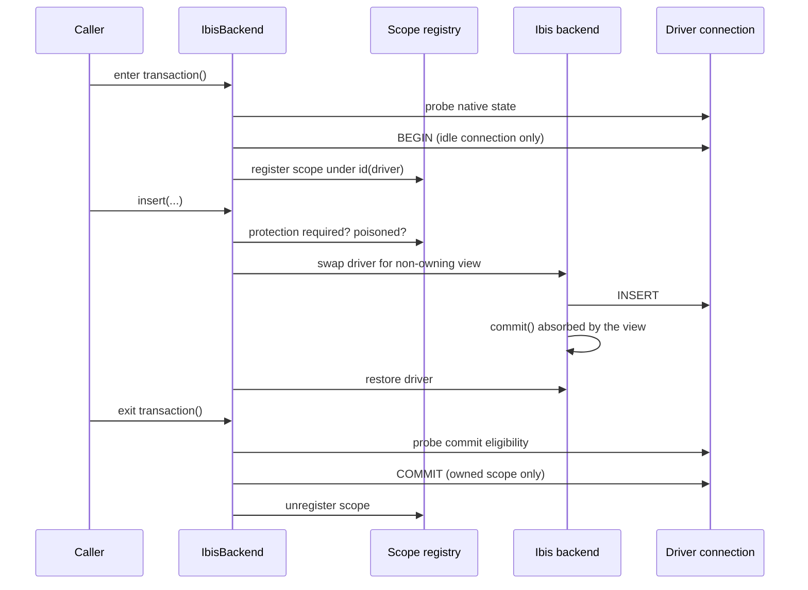

# Transaction and adoption internals

Behind `IbisBackend.transaction()` sit three mechanisms: a guard around every package operation that stops Ibis from completing the caller's transaction, a process-wide record of open scopes keyed on the native driver connection, and an exit check that decides whether a scope may commit. Connection adoption adds a fourth: capturing the session settings Ibis overwrites when it wraps a caller's driver connection, and putting them back. The user-facing behaviour is described in [Transactions](../10-transactions/index.md) and [Adopting existing connections](../11-adopting-existing-connections/index.md); the dialect fields these mechanisms read are part of the `DialectSpec` data described in [How one backend serves 20 dialects](../14-how-one-backend-serves-20-dialects/index.md).

<!-- concept:131 -->
## Protected package calls

Ibis completes transactions on its own internal paths. Its SQLite backend runs writes through a `begin()` context that calls the driver's `commit()` on success and `rollback()` on error, and its PostgreSQL backend wraps internal work in psycopg's `connection.transaction()`. Inside a package scope, either would end the unit of work early. A protected call prevents that for the length of one package operation. The user-level effect is described under [Transaction scopes](../10-transactions/index.md#transaction-scopes).

Names with a leading underscore are private and can change without notice. Every `IbisBackend` operation that reaches the database, and every inspection query on `IbisConnection`, runs inside `IbisConnection._protected()`, which delegates to `protected_call()` in `_protected.py`. On entry it:

1. Resolves the real driver handle with `real_driver_handle()`, unwrapping a protection view if one is already installed.
2. Asks the registry, through `protection_required()`, whether a scope is registered on that handle on an ownership dialect. No scope, or a non-ownership dialect, means the call runs unprotected and the context yields `False`.
3. If the registered scope is already poisoned, `protection_required()` raises `TransactionPoisonedError` before the operation does any database work.
4. For the Ibis backends that complete transactions internally (SQLite and PostgreSQL, listed in `_COMPLETING_IBIS_BACKENDS`), replaces the driver attribute on the Ibis backend object with a `_NonOwningDriver` view. The view forwards every attribute to the real driver, but its `commit()` and `rollback()` do nothing and its `transaction()` context yields without opening a savepoint. DuckDB is not swapped; the module treats its Ibis paths as not completing transactions on their own, and the DuckDB scope tests confirm the rollback cases.

On exit, any exception escaping the operation marks the scope poisoned through `mark_poisoned()`, and the original driver attribute is restored in a `finally` block. A protected call nested in another (`inspect_namespace()` calls `list_tables()`, for example) sees the view already in place and neither swaps again nor restores early.

The context yields whether the call is protected. Inspection methods use it to decide how to handle a failed metadata query: outside a scope they keep their print-and-fall-back behaviour, inside one they re-raise. `raw_driver_connection()`, `native_transaction_open()` and `close()` all resolve the handle through `real_driver_handle()`, so a caller never receives the view.

The guard only covers package calls. The same Ibis write issued directly on `backend.ibis_connection()` still commits:

```python
import polars as pl
from mountainash_data import IbisBackend
from mountainash_data.core.errors import TransactionIntegrityError

with IbisBackend(dialect="sqlite", database=":memory:") as backend:
    raw = backend.raw_driver_connection()
    raw.execute("CREATE TABLE sales (id INTEGER, total INTEGER)")
    raw.execute("INSERT INTO sales VALUES (1, 120)")
    raw.commit()
    replacement = pl.DataFrame({"id": [9], "total": [0]})

    # Through the package: Ibis's internal commit is absorbed.
    try:
        with backend.transaction():
            backend.insert("sales", replacement, overwrite=True)
            print("native open after insert:", backend.native_transaction_open())
            raise ValueError("abandon")
    except ValueError:
        pass
    print(raw.execute("SELECT * FROM sales").fetchall())

    # Straight to Ibis: its commit ends the scope's transaction.
    try:
        with backend.transaction():
            backend.ibis_connection().insert("sales", replacement, overwrite=True)
            print("native open after insert:", backend.native_transaction_open())
    except TransactionIntegrityError as exc:
        print(f"{type(exc).__name__}")
    print(raw.execute("SELECT * FROM sales").fetchall())
```

```text
native open after insert: True
[(1, 120)]
native open after insert: False
TransactionIntegrityError
[(9, 0)]
```

The second scope could only detect the early commit at exit; the overwrite had already persisted.



## The per-raw-handle scope registry

Open scopes are recorded in a module-level dictionary, `_ACTIVE`, in `_transaction.py`, guarded by a `threading.Lock`. The key is `id(raw_handle)`, the identity of the native driver connection, not of the `IbisBackend` wrapper. Two backends wrapping one driver connection therefore share a scope, which is what makes the cross-wrapper behaviour in [Nested scopes are flat](../10-transactions/index.md#nested-scopes-are-flat) work:

```python
from mountainash_data import IbisBackend

with IbisBackend(dialect="duckdb", database=":memory:") as backend:
    other = IbisBackend.from_ibis_connection(backend.ibis_connection(), dialect="duckdb")
    with backend.transaction():
        print(other.in_transaction())
```

```text
True
```

Each entry is a `_TxState`:

| Field | Meaning |
|---|---|
| `depth` | Current nesting depth of scopes joined to this unit. |
| `poisoned` | Set by a failed nested scope or protected call; the unit can no longer commit. |
| `owns` | Whether the outermost scope began the native transaction and so completes it. |
| `selected` | Whether this is an ownership dialect, which turns on protected calls and the exit eligibility check. |

`run_transaction()` handles entry and exit. On entry it looks the handle up. If a scope is already registered, the call joins it flatly (`_join()`): it is refused if the unit is poisoned, increments `depth`, and poisons the unit if the body raises. Otherwise the call becomes the outermost scope. On an ownership dialect, `_observe_entry()` runs the dialect's `in_transaction_probe`. `False` means idle, so the scope owns the unit. `True` means a caller transaction is open, so the scope joins without owning. A missing probe, a probe that raises, or a `None` result raises `TransactionIntegrityError` before any statement runs. An owning scope then begins the transaction with the dialect's `begin_hook` if it has one, otherwise its `begin_statement`; PostgreSQL's hook avoids a redundant `BEGIN` when autocommit is off, as described under [Owned and joined transactions](../10-transactions/index.md#owned-and-joined-transactions). Only after that does the scope register itself, so a failed `BEGIN` leaves no stale entry.

On exit from the outermost scope, the order is:

1. If the body raised, an owned unit is rolled back and the original exception propagates; a rollback failure is attached to it. A joined unit is not touched.
2. If the unit is poisoned, a joined scope raises `TransactionPoisonedError` without completing anything; an owned scope rolls back and then raises it.
3. On a non-ownership dialect, the scope sends `COMMIT`.
4. On an ownership dialect, `_finish_selected()` checks eligibility, using the dialect's `precommit_probe` if it has one (PostgreSQL, where an aborted transaction is open but cannot commit) and otherwise the presence probe.
5. The registry entry is removed in a `finally` block whatever happened.

The eligibility check resolves as follows:

| Probe result | Owned scope | Joined scope |
|---|---|---|
| Eligible | `COMMIT`. If it fails, the error propagates without retry and the backend discards a connection it opened itself. | Returns; the caller completes. |
| Transaction has ended (raw `COMMIT` or `ROLLBACK`) | `TransactionIntegrityError`; nothing to roll back. | `TransactionIntegrityError`. |
| Open but not eligible, or unknown | Best-effort `ROLLBACK`, then `TransactionIntegrityError`. | `TransactionIntegrityError`; the caller's transaction is left as is. |
| Probe raised | Best-effort `ROLLBACK`, then `TransactionIntegrityError` with the probe error as its cause. | `TransactionIntegrityError`. |

`BEGIN`, `COMMIT` and `ROLLBACK` go through `raw_execute()` in `_raw.py`, because DB-API drivers do not agree on a connection-level `execute()`. It uses the handle's `execute()` when there is one (sqlite3, DuckDB, psycopg 3, pyodbc) and otherwise a cursor that it closes afterwards (mysqlclient, oracledb, trino). A dialect's `raw_execute_hook` would replace the transport entirely; no dialect sets one at `2d0782b`.

Three read paths use the registry. `is_active()` backs `in_transaction()` and the `close()` guard, and never mutates the registry. `protection_required()` and `mark_poisoned()` serve protected calls.

<!-- concept:137 -->
## Session-option snapshot and restore

Ibis's `Backend.from_connection()` runs the backend's post-connect setup on the connection it is given. For DuckDB in Ibis 12.0.0, that sets the session `TimeZone` to `UTC` and `python_enable_replacements` to `false`. When the connection is the caller's own, those changes leak into the caller's session. The adoption API itself is covered in [Adopting existing connections](../11-adopting-existing-connections/index.md).

Each dialect declares the options Ibis changes as `DialectSpec.adoption_mutations`, a tuple of `SessionOption(name, read_sql, render_set)` records in `dialects/_registry.py`. `read_sql` returns the current value as a scalar; `render_set` turns a value into the statement that sets it. DuckDB and MotherDuck declare `python_enable_replacements` and `timezone`. Boolean values render as fixed tokens and string values are escaped as SQL literals through sqlglot, because `apply_session_options` values come from the caller. No other dialect declares any.

The helpers live in `src/mountainash_data/backends/ibis/_adoption.py` and are called from `backend.py`. `from_raw_connection()` controls the raw-to-Ibis step, so it can capture state before Ibis touches it:

1. It refuses dialects whose `raw_adoption_verified` flag is false (everything except DuckDB and MotherDuck) with `NotImplementedError`.
2. With `preserve_session=True`, `snapshot_options()` reads each declared option through `raw_fetch_scalar()`. An option that cannot be read is skipped with a warning, because a value that was not captured cannot be restored. Options without `read_sql` are skipped silently.
3. It calls Ibis's `from_connection()`.
4. In a `finally` block, `restore_options()` replays the captured values, so a failed adoption still leaves the caller's session as it found it.

`from_ibis_connection()` receives a connection Ibis has already built, so the original values are gone. Its `apply_session_options` argument instead applies an end state the caller declares, through `apply_options()`; names that are not declared mutations for the dialect are ignored with a warning, once per name.

```python
import duckdb
import ibis
from mountainash_data import IbisBackend

SETTINGS = "SELECT current_setting('TimeZone'), current_setting('python_enable_replacements')"

for preserve in (False, True):
    raw = duckdb.connect()
    raw.execute("SET TimeZone = 'Australia/Sydney'")
    backend = IbisBackend.from_raw_connection(raw, dialect="duckdb", preserve_session=preserve)
    print(f"preserve_session={preserve}:", raw.execute(SETTINGS).fetchone())
    backend.close()

raw = duckdb.connect()
IbisBackend.from_ibis_connection(
    ibis.duckdb.from_connection(raw),
    dialect="duckdb",
    apply_session_options={"timezone": "Australia/Sydney"},
)
print("apply_session_options:", raw.execute(SETTINGS).fetchone())
```

```text
preserve_session=False: ('UTC', False)
preserve_session=True: ('Australia/Sydney', True)
apply_session_options: ('Australia/Sydney', False)
```

The last line shows the difference between the two paths: `apply_session_options` sets only the options it is given, so `python_enable_replacements` keeps the value Ibis set.

## Invariants and known Ibis couplings

These invariants hold across the transaction and adoption code. Each is checked by the tests named; changes to these modules should keep them.

| Invariant | Where it is enforced | Tests |
|---|---|---|
| The package never changes the driver's autocommit setting. | `_transaction.py`; PostgreSQL's begin hook in `dialects/_registry.py` | `tests/test_live_backends/test_transaction_live.py` (fixture asserts autocommit unchanged) |
| A scope registers only after `BEGIN` succeeds, and always unregisters. | `run_transaction()` | `test_begin_failure_leaves_no_registry_entry` in `tests/test_unit/backends/ibis/test_transaction.py` |
| A joined scope never sends `COMMIT` or `ROLLBACK`. | `run_transaction()`, `_finish_selected()` | joined-scope cases in `tests/helpers/transaction_cases.py`; `test_joined_*` in `test_transaction.py` |
| A scope that cannot see native state neither starts nor joins. | `_observe_entry()` | `test_unknown_entry_state_refuses_before_any_sql` |
| An ambiguous `COMMIT` is never retried, and an owned connection is discarded. | `_finish_selected()`, `IbisBackend._discard_connection()` | `test_commit_failure_calls_callback_once_without_retry` |
| No database work runs in a poisoned unit. | `protection_required()`, `_join()` | `test_caught_operation_failure_poisons_scope`, `test_sqlite_conflict_rollback_then_drop_is_refused` in `test_transaction_scope.py` |
| A connection cannot be closed inside its scope. | `IbisConnection.close()` via `is_active()` | `test_close_inside_scope_refused` |
| `in_transaction()` never raises and never mutates the registry. | `IbisBackend.in_transaction()`, `is_active()` | `test_is_active_does_not_mutate_registry`; the `test_in_transaction_*` cases in `tests/test_unit/backends/ibis/test_backend.py` |
| Session options are captured before Ibis adoption and restored even if adoption fails. | `from_raw_connection()` | `test_from_raw_connection_preserves_python_enable_replacements` in `test_backend_adopt.py` covers the success path; the failure path has no direct test. |
| An unreadable session option warns rather than being skipped silently. | `snapshot_options()` | `test_snapshot_warns_when_read_raises` in `test_adoption.py` |

Two limits are by design. The registry gives sequential reentrancy on one driver connection, not arbitration between threads sharing it; a driver connection is not safe for concurrent use anyway. Keying on `id()` means a freed handle's identity could be reused, which is safe only because entries are removed in `finally`. `_protected.py` also has no unit test of its own; it is covered through the scope tests above.

The code depends on Ibis behaviour that is not public API. Each coupling below was checked against Ibis 12.0.0, the minimum the package requires, and is a candidate for breakage on an Ibis upgrade:

| Coupling | Used by | Ibis behaviour relied on |
|---|---|---|
| Driver attribute on the Ibis backend object (`con`; `client` for BigQuery; the private `_session` for PySpark) | `raw_handle_attr` in `dialects/_registry.py`; `real_driver_handle()`; the protection swap | The attribute holds the native driver connection and is read on every use, so replacing it for one call takes effect. |
| Internal completion on SQLite and PostgreSQL | `_COMPLETING_IBIS_BACKENDS` and `_NonOwningDriver` in `_protected.py` | SQLite's `begin()` calls `con.commit()` / `con.rollback()`; PostgreSQL wraps work in `con.transaction()`. If Ibis completes through another route, the view no longer absorbs it. |
| Backend `name` attribute | `protected_call()` | Identifies which Ibis backends need the swap. |
| `from_connection()` running post-connect setup | `from_raw_connection()`; `_DUCKDB_ADOPTION` | The set of session options Ibis changes on DuckDB. A new mutation needs a new `SessionOption`. |
| `_register_in_memory_tables()` and the backend's memtable record | `src/mountainash_data/backends/ibis/_render.py` (upsert staging) | Staging memtables explicitly before compiling raw SQL. The same record is what goes stale after a rollback, the [memtable rollback caveat](../10-transactions/index.md#the-memtable-rollback-caveat). |
| `_to_catalog_db_tuple()`, `_to_sqlglot_table()` and `begin()` | SQLite truncate hook in `dialects/_registry.py` | Resolving the table and running `DELETE` the way Ibis's own overwrite insert does; inside a scope its commit is absorbed by the protection view. |

The live-database tier (`tests/test_live_backends/`) is the place these couplings are exercised against PostgreSQL; [Contributing and testing](../18-contributing-and-testing/index.md) describes how to run it.
